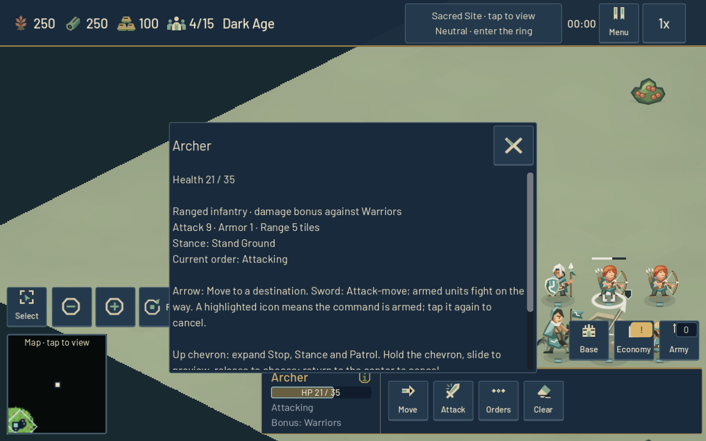
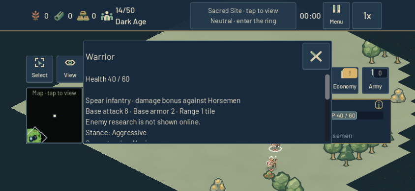
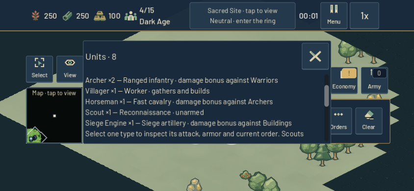

# Read the selected army — 24 October 2026

Mixed selections now show readable names and counts in the existing two-line summary. Two-type armies list both types; larger groups show their largest contingent and the number of other types. Tap Info provides the full roster and each role's documented damage bonus. It describes bonuses, not guaranteed combat outcomes. Scouts remain explicitly unarmed.

| Before, maximum phone scale | After, same modeled selection |
| --- | --- |
|  |  |

Group HP uses a compact percentage, while Info preserves the exact combined current/maximum health and selected-unit count. Armed Move, Attack-move and Patrol prompts take priority over composition. The existing 80px dock, command buttons and touch Info target remain; no new runtime controls, per-frame work or world-actor scans were added.

Single-type inspection now exposes the supplied attack, armor, range, stance and order through touch Info instead of only a mouse tooltip. For multiple units of one type, order and stance are explicitly labeled as the first unit's values. Mixed groups do not inherit that unit's combat stats.

| Before, desktop Info | After, supplied upgraded Archer stats |
| --- | --- |
|  |  |

Review caught a pre-existing provenance problem in the tooltip: client snapshots disclose only the local player's research. Main now marks an online enemy's attack/armor as base values, and Info explains that enemy research is not shown online. Own online upgrades and native enemy effective values remain accurate; the protocol and hidden information are unchanged.

## Verification and evidence

`tools/test_army_selection_readability.tscn` exercises production Main, SelectionManager, HUD and actual client replica snapshot application. The final candidate passes **468 native and 468 headless checks**, with zero runtime errors/warnings. The baseline passes 249 common checks while recording nine clipped states; the candidate records none. Both cover 30 states across desktop 1280×800, phone 844×390, and phone Extra Large 1.15 with modeled side/bottom insets and browser clearance. Every candidate detail/meter line is measured against a **96px minimum budget**, including `Warrior ×30` and `+5 other types`.

Touch opens/closes Info; ordinary wheel events reach overflow. Intermediate captures preserve every roster entry at normal and maximum phone scale. Stable selection order, retained command nodes, enemy command restrictions and clearing old selection information also pass. Real snapshot replicas test both server-slot remappings: own +2 attack/+1 armor produces Archer 9/1; deliberately stale enemy +5/+3 is ignored online, yielding labeled base Warrior 8/2. The same native enemy correctly shows effective 13/5.

Four compatibility suites passed before the final enemy-stat provenance extension: mobile HUD composition, secondary surfaces, 440-check selection-state clarity and hold controls. The final 468-check runs validate the extension. Earlier receipts remain distinct.

The frozen pair starts from `b0e484c3de79226d883db89bcc6f8934896172a8`. Its only runtime differences are `scripts/ui/hud.gd` and `scripts/main/main.gd`; `project.godot` differs only to isolate fresh private preferences. Other art/runtime files and the final fixture are identical. These are modeled presentation/replica checks, not paid matches, live networking, browser or physical-phone tests, or performance measurements.

The first preparation stopped on an unsupported Python tarfile keyword before engine launch. The first baseline fixture then exposed incomplete wheel input and a modeled safe area being reset after deferred layout. Fixture-only corrections resolved those failures; their original receipts/logs are retained, alongside successful intermediate runs.

[Durable evidence](evidence/army-selection-20261024.json.gz) preserves 66 exact text receipts and 406 external image hashes, including failures, source manifests, runtime diff, fixture source and compatibility logs. SHA-256: `f517722d69826db46b9158240071ee943e0c87a09475767b6f2364efcfb3b275`. Full local evidence is under `output/combat-readability-2026-10-24/`; frozen projects are excluded from the archive. The manifest's additional PNG references are committed runtime assets, already source-hashed, rather than missing evidence captures.
