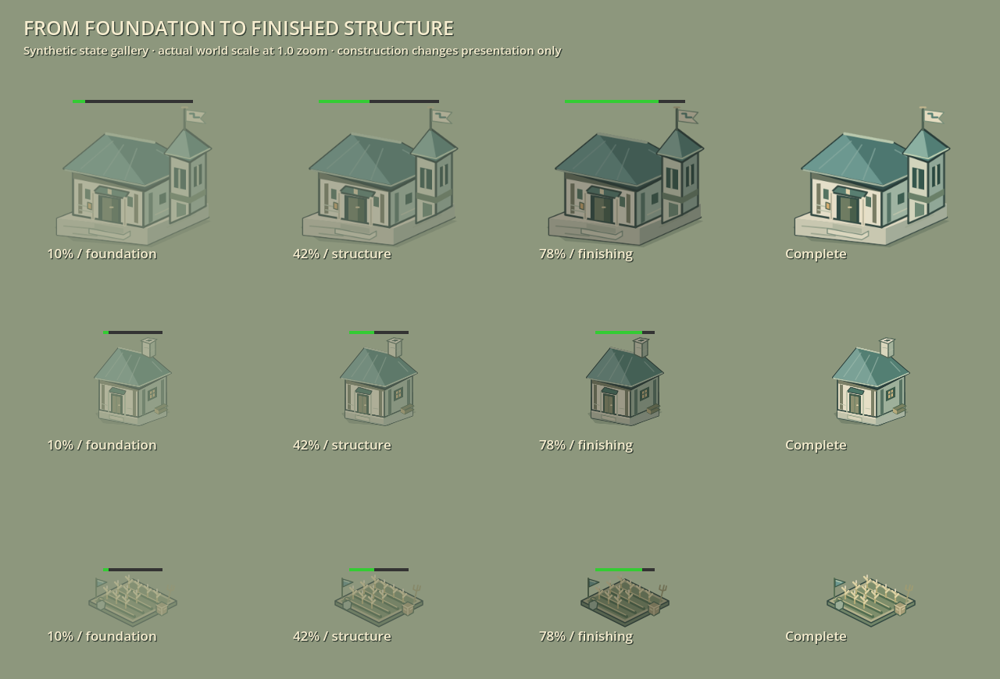
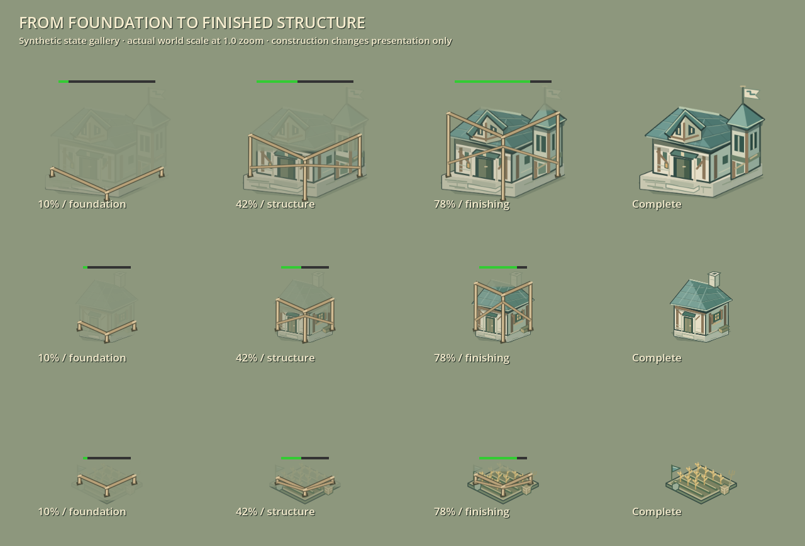

# Company architecture and construction — 24 October 2026

The building presentation pass starts from clean `b0e484c`. It preserves the existing Company teal/clay identity, footprints, collision, authored scales, ground anchors and defensive firing points. No building statistics, costs, training, construction timing, targeting, damage amounts or pathfinding change.

## Visible changes

Ten original SVG masters and their matching opponent variants gain broad roof courses, stronger eave depth, restrained stone joints and warm structural timber. The Town Center receives a front civic gable; the House gains framed shutters; Barracks get stone door piers and short standards; Stable/Fletchery/Workshop retain their open working bays with stronger bracing. The supply camp keeps visibly folded canvas, the forge has a blackened eave, and Farm grain gains warm ears. Watch Tower stone remains neutral around a clearer ownership drape. The palette generator now derives all ten families from one master each, preserving matching alpha masks.

| Before, ordinary phone-sized viewport | After, same view |
| --- | --- |
|  |  |

Construction now reveals the structure from its footing upward while retaining a faint identifying silhouette. Three temporary timber stages distinguish foundation, structure and finishing; Farms use low planting frames. Completed structures remove the frame node and reveal material. The old construction tint darkened with progress; it now approaches the active material color.

Healthy building hit modulation previously tweened white to white. Actual HP loss now produces a short warm pulse using `self_modulate`, separately from construction/ownership/death modulation. Repeated hits restart one tween, zero damage produces no hit, reduced flashes suppress it, and destruction clears it so a late tween cannot restore a destroyed building. Online timer integration is validated separately by the aggregate network fixture.

| Previous construction | New construction |
| --- | --- |
|  |  |

## Matched evidence and cost

`output/building-character-2026-10-24/baseline` is an archive of `b0e484c`; `candidate` changes only building runtime/assets plus the identical capture fixture. Concurrent unit/HUD changes are excluded. Captures use Godot 4.6, Metal on Apple M4, fixed source and roster, camera, viewport and preferences. World views use 0.952 zoom; galleries use actual world scale at 1.0. These are synthetic scenes, not paid matches, physical-phone tests or frame-time benchmarks.

| Matched view | Nodes before → after | Draws before → after |
| --- | ---: | ---: |
| Civic/military gallery | 80 → 80 | 35 → 35 |
| Work/defense gallery | 80 → 80 | 49 → 49 |
| Village 1280×800 | 953 → 953 | 264 → 264 |
| Village 844×390 | 953 → 953 | 253 → 253 |
| Nine foundations plus three finished structures | 90 → 99 | 50 → 59 |
| Hit-response gallery | 78 → 78 | 35 → 35 |

The temporary frame costs one node/draw per constructing structure in this fixture. Idle completed structures retain their prior render structure. The construction shader is used only while building; these counters do not establish GPU duration or whole-match performance.

Final native results: candidate **240 checks**, baseline **144 common checks**, zero failures/errors/warnings. Candidate headless contracts pass **216 checks**. Coverage includes all ten imports/owner alpha masks, canonical ground/collision/scale, transparent/opaque facade picks, camera bounds, disabled-process replica construction refresh, completion cleanup, actual repeated/zero/lethal damage and reduced flashes. At 99.9% construction, **5,106 opaque native pixel samples** across Town Center, House and Farm differ from active material by at most **one RGB8 channel value**. Visible ink is checked so empty-background comparisons cannot pass.

`comparison.json` establishes identical physical geometry and synthetic roster/camera/viewport. Native logs, complete source SHA-256 manifests, counters, enlarged ownership galleries, hit images and parity images are beside the captures. The first attempt is preserved: its fixture retained content scaling after a small parity window, invalidating village/parity images and emitting one negative-rectangle layout diagnostic. Explicit scale reset and resize settling fixed the fixture; both stages were rerun cleanly. An initial shader double-texture expression was corrected during source review before any engine launch.

Eight compatibility suites pass cleanly: imported Company art, actual network replicas, facade selection, world proportions, depth sorting, foundation builder feedback, Town Center defense and touch placement. The old replica fixture expected the Watch Tower's obsolete whole-sprite red tint and failed identically on the baseline. It now covers all ten neutral-material families and verifies construction reveal/frame cleanup on disabled replicas. Its first edit also exposed a fixture-only `--script` load-order issue; preserving the existing deferred script load fixed that attempt. All original failure logs remain.

Receipts are in `output/building-character-2026-10-24/compatibility.json`. Durable text/source receipts and screenshot identities are archived in `docs/evidence/building_character_2026-10-24.json.gz`; selected PNGs above are tracked directly. The archive does not embed the remaining screenshot bytes. Final aggregate match/network/performance validation belongs to the main iteration report.
