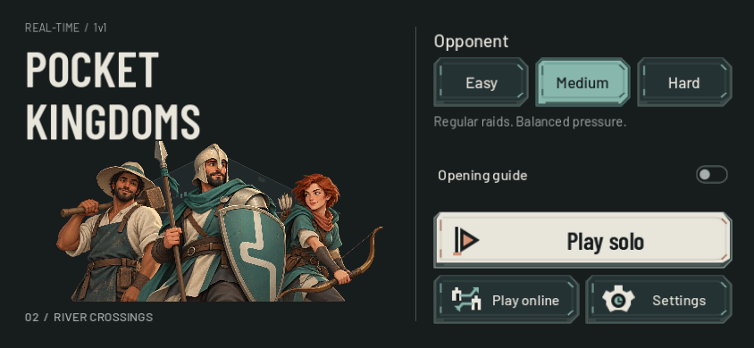

# Company, controls and battlefields — 22 October 2026

This release gives Pocket Kingdoms an original Builder/Warrior/Archer identity, custom command artwork, three selectable maps, better melee spacing and an AI economy recovery fix. The browser welcome and native menu share the character composition, fonts and button artwork. It preserves the existing paid economy, production rules and authoritative online model.

## Gameplay

Open Plains preserves the classic generator. River Crossings creates three broad routes through a separating river. Woodland Flanks creates forest bands with alternative approaches. Settings exposes all three without scrolling; solo preference persists, while online opponents agree on the server’s seed and map without overwriting that preference. Legacy/mixed-version pairs retain the classic map. See [map topology and fairness](map_archetypes_2026-10-22.md).

In-range melee units now make limited room for allies while preserving target, attack cadence, walkability and enemy body bounds. The final measured clash reduced severe friendly overlap 52.5%; it did not eliminate all sprite overlap. Infantry clashes, cavalry flanks, withdrawal/reengagement and multiple-route reinforcement scenarios exercise both automatic and deliberate command policies. See [72-case tactical matrix and tradeoffs](combat_scenarios_2026-10-22.md).

Paid policy matches exposed a late-game food-heavy workforce that could not rebalance because one worker remained idle. Removing that blanket gate lets the existing bounded allocation correction fund replacements. Fourteen paid runs include ten natural Sacred results and four active 900-second horizons; they do not establish universal short matches or human balance. See [paid cadence comparisons](paid_ai_cadence_2026-10-22.md).

## Visual work

The [design direction and research](visual_direction_2026-10-22.md) records the relevant Clash Royale, Polytopia, Bad North and mobile RTS references. The cast, 45 icons, app mark and nine-slice command plates are original assets. The [illustration provenance](field_company_art_2026-10-22.md) includes the exact generation prompt. Team cloth, terrain, objective feedback, resource labels and impact effects share a calmer palette. Existing non-Farm building sprites retain their earlier artwork.

Menu, Settings, build cards, production, command popovers, Pause and results now share type and controls. Armed/pressed controls have a distinct mineral state; selected Repeat uses the bone primary plate. Minimap actors have dark edges so ownership colours remain visible over terrain.

## Validation

- Final native touch journey: 12 phone/scale/safe-area profiles; paid Train/Repeat/queue refunds, Build/Cancel/Place, unit selection, Move/Attack, camera centring, minimap and live resize. No GUI gesture leaked into a world order.
- Final isolated native map selection: all three choices save correctly and launch the expected generated terrain at both phone sizes/scales. A concurrent capture had overwritten shared test preferences; the isolated rerun passes.
- Native visual review: 12 menu profiles, 20 Settings screens, 60 integrated states and 12 queue pages. Source-only cosmetic refinements after those captures were checked in the final rendered run.
- Focused regressions cover pointer routing, build placement/layout, production/rally, Sacred profiles, combat priorities/spacing, AI allocation, command icons and online visual feedback. The resource-targeting fixture now transforms injected positions through the viewport exactly like the other phone fixtures; unchanged assertions pass at scales 1.0 and 1.15. Both baseline and current runtime had the same old fixture failure at 1.15.
- Map validation covers 105 generated maps plus the existing 64-seed expansion fairness probe. Online map compatibility and paired strategy/economy/combat checks have separate receipts.

The 72-case battle matrix and three final paid confirmations predate presentation-only edits. An eight-case deterministic replay after the art changes matched all gameplay metrics and trajectories, excluding CPU timing. Native rendered frame timings are desktop measurements; browser touch emulation is not a physical-phone certification. Competitive balance, human APM and prolonged mobile thermal/battery behaviour remain open playtest work.

Generated logs and captures are under `output/visual-redesign-2026-10-22/`, `output/battle-art-2026-10-22/`, `output/combat-scenarios/`, `output/ai-cadence-20261022/` and `output/battlefields-2026-10-22/`.

## Rendered desktop timing

A normal-speed paid River 101 match sampled four eight-second-or-longer windows after first contact at 151.44 game seconds. The warmup ran at 3×; sampling ran at 1×, with no fixed FPS, on native Metal/Apple M4. Across 844×390 and 932×430 at zoom 0.65/1.6, wall-frame median was 8.35–8.43ms, p95 was 9.35–9.51ms and p99 was 12.99–14.29ms. The preceding 3× stress run reached 49 units and 22 buildings; later windows had p95 wall intervals 34.73–37.51ms. These are different match phases and speeds, not a controlled performance A/B. No physical-phone or Web frame-rate claim follows.

Evidence: `rendered-paid-1x-performance.json`, `rendered-paid-performance.json` and their paid-match/source-hash receipts under the visual output directory. Both processes exited cleanly. The last palette-only team/objective changes and objective-label clamp followed this timing sample; the final native battlefield-feedback pass checks those displayed changes.

## Public release

Live at https://game.4mn.org, version `0.2.0-beta.2`, clean runtime `334fd81a70fb`, staged source `8e935c1ce9aef037f622f3be9f7ff3a26b2d0e8311b21f63ecdad3af3693b386`. Published at `2026-10-22T02:36:43Z`. Both reproducible exports and all 39 public decoded hashes pass. The public game container was restarted; the authoritative container was rebuilt/recreated after verifying no active match connection. Diagnostics remains healthy. Exact images, rollback and service times are in the [deployment receipt](debian_game_deployment.md).

Final-source local and public WSS suites pass paired Strategy controls, connection failures, delayed loading/terminal races, lifecycle, paid movement/training/construction/deposits, and paid infantry combat with replicated damage. Public new/new clients agreed on River map seed 69936340 and preserved solo map preferences on leaving. Legacy, mixed and current map-catalog pairs also pass against the deployed service. Evidence: `output/battlefields-2026-10-22/online-public-release/` and `online-public-map-catalog/`.

The packaged browser welcome, native menu, Settings and solo launch were visually inspected at 844×390 with touch enabled. Original illustration, custom SVG plates, fonts and icons render from the actual exported pack. The public console has no application errors; local static preview 501 responses came only from its intentionally absent diagnostics POST endpoint.

Two independent public Chromium touch sessions also joined match 8 on Woodland Flanks, seed 348233093. Actual taps selected the Town Center, paid 50 food for a Villager, and enabled Repeat; the server snapshot confirmed the queued unit and repeat flag. Leaving through Match Menu returned the first client to its saved River Crossings solo choice and produced an opponent-disconnected victory on the second. Both test sessions were then closed. Captures and observed WebSocket receipts are under `output/playwright/company-*`. These are browser touch tests, not a physical-phone performance measurement.
