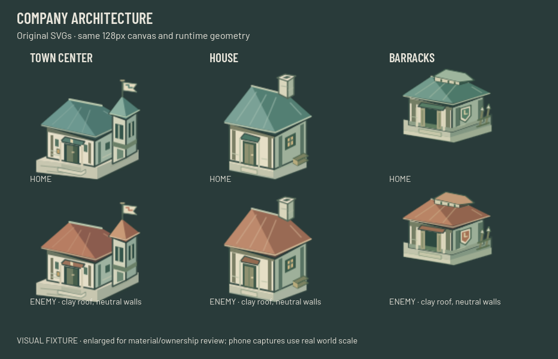
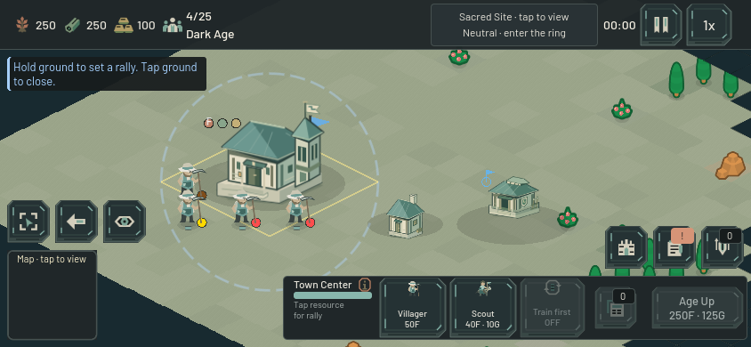

# Original Company buildings — 22 October 2026

The Town Center, House and Barracks now use original SVG architecture matching the Company characters. The Town Center is a public assembly hall with a narrow route lookout, sheltered entrance and pennant. Housing has a compact pitched roof, hearth chimney and warm window. The Barracks has a low broad roof, open armory door, shield sign and spear rack. Bone masonry, dark structural edges and weathered timber support mineral-teal roof planes.

Enemy variants change the roofs, awnings and Company marks to clay while retaining neutral stone, bone and wood. `tools/build_company_building_palettes.py` derives these variants from the three editable home masters. Generation is deterministic; both XML geometry and every rasterized alpha pixel match between each home/enemy pair. Remaining legacy building families retain their previous art and tint.

The runtime change is limited to sprite selection, material-aware ownership tint and the three matching HUD icon references. A late owner assignment refreshes the cached texture. The network adapter already sets local owner and type before adding a replica to the scene; its existing construction appearance refresh selects the same materials.

| Contract | Town Center | House | Barracks |
|---|---:|---:|---:|
| Texture canvas | 128×128 | 128×128 | 128×128 |
| Existing sprite scale | 1.08 | 0.45 | 0.60 |
| Existing sprite offset Y | −38.4 | −19.2 | −28.8 |
| Existing tile footprint | 4×4 | 2×2 | 3×3 |
| Existing collision rectangle | 256×128 | 128×64 | 192×96 |

These geometry contracts, import scale 1.0, production, prices and construction rules are unchanged. Visible facade discovery follows the new artwork; the existing deliberate Town Center/Barracks facade touch points still pass against nearby unit and resource hit rings.

The image above is an explicitly synthetic visual fixture in the real Main/GameMap/HUD scene. The two extra structures are completed fixtures, so this image makes no paid-match claim. Native captures cover 844×390 and 932×430 at zoom 0.952 and 1.6; the material sheet also reviews both owners. Tests ran in a copied project with a separate Godot user-data directory, avoiding shared preference races.

Validation passed:

- New `test_company_building_art`: imported textures, unchanged size/scale/anchor/footprint/collision, ownership palettes and alpha, late-owner refresh, construction fade; native phone and material captures.
- New `test_company_building_replica`: actual snapshot adapter, slot-one ownership remap, all three Company families plus a legacy building, reconstruction and construction fade; replicas remain inert. This is a presentation fixture, not a live network connection.
- `test_building_facade_selection`: actual viewport touch/mouse at three zooms, body priority, construction and resource-neighbor cases.
- `test_human_construction_assignment`: paid natural House/Barracks construction, newborn labor, resource/cargo preservation and canceled-order behavior.
- `test_enemy_building_controls`, `test_town_center_defense`: inspect-only ownership guards, friendly actions and 41 defense checks.
- Before the ownership-only refinement, `test_touch_building_reselection`, `test_touch_placement_preview`, `test_build_menu_placement_transition` and `test_repeat_production` also passed with the same geometry and sprite mappings.

Machine-readable results, exact asset/source hashes, logs and all native captures are in `output/company-buildings-2026-10-22/`. This is focused art and interaction evidence, not a full suite rerun or a new balance/performance claim. No PNG source was altered and no image-generation tool was used for these buildings.
