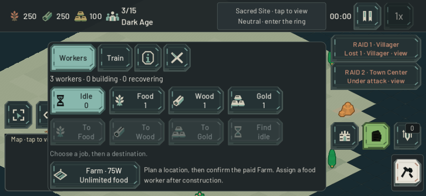

# Your company, in the field — 22 October 2026

Version `0.2.0-beta.4` brings the Builder, Warrior and Archer identities into the existing battlefield pieces, adds original Resource Camp, Archery Range and Stable silhouettes, and resolves two management-layer conflicts. See the [unit art receipt](company_units_2026-10-22.md) and [specialist building receipt](company_specialist_buildings_2026-10-22.md) for materials, geometry and selection evidence.

## Management and urgent information

Opening guidance now retains its current text while hiding behind secondary surfaces and modals. Closing those surfaces restores the latest instruction; it neither advances nor dismisses the lesson. Placement guidance remains visible, and Skip still clears the lesson. The text uses the existing parchment/teal palette.

Economy and Army previously obscured part of the left-hand raid lane. Their two recent owned-attack alerts now use the exposed right-hand space above the management launchers. The dismissal shield tracks the alerts' actual visible bounds. One tap closes management and focuses the attacked location, preserving the selected units. This does not inspect enemies or change fog. Other overlay layouts and ordinary toast placement are outside this change.

## Verification

- Four integrated native touch journeys: 844×390 and 932×430, Standard and Extra Large. Actual ScreenTouch dispatch opens/closes Economy, Army, Build and Pause; updates a lesson behind management after controlled selected-worker death; reaches both raid cards; preserves surviving selection; restores current guidance; retains placement guidance; and keeps Skip cleared. No world orders leak through the interface. Natural queued layout is used.
- Twelve native geometry profiles: both phone sizes, three interface scales and plain/synthetic-notched safe areas. Field, Economy and Army produce 36 captures. Both raid targets remain at least 48 logical pixels high, text fits, and their bounds avoid the panel and launcher rail. The synthetic-inset fixture reapplies its explicit bounds after queued native layout, because a Mac display cannot supply the fixture's imaginary notch.
- Existing lesson cleanup and all 10 guidance strings across 12 phone profiles pass. The lesson-string fixture emitted one nonfatal ObjectDB cleanup warning; the final integrated touch journey exits cleanly.
- Browser touch emulation of the actual beta.4 development export: Chromium, 844×390, DPR3, Extra Large, synthetic asymmetric 53/24/0/21 insets. Canvas remains844×390 at(0,0). Economy/Army hide the guide and closing management restores it. Local static hosting cannot accept diagnostics POSTs (expected 501); no game runtime errors occurred. Public clean-artifact verification is recorded separately below after deployment.
- Independent review found no actionable input-routing, visibility-lifecycle, modal-priority or fog/privacy defect in the two UI diffs.

Local evidence: `output/guidance-priority/`, `output/management-raids/`, `output/playwright/company-field-preview-*.png`. Native fixtures hold AI/economy where needed and generate controlled owned-attack reports. They are not full-match, physical-phone or human-balance certification. Combat and economy rules remain unchanged in this release.

## Tactical follow-through

The separate paid tactical comparison buys its rosters through ordinary gathering, construction and queues before explicitly staging controlled engagements on all three map styles. It compares composition, attack route and a same-roster extra staging order. Treat its receipts as tactical fixture evidence, not equal-budget or full-match balance evidence. Keep any future teaching or target-acquisition change bounded and test it separately from this visual release. See [paid tactical plans](paid_tactical_plans_2026-10-22.md).

## Published verification

Live at https://game.4mn.org as clean `0.2.0-beta.4`, runtime `0a45f90e90b8`, staged source `10c7d4300daf36231b33b13dc1c01f1f55c0739e73854b21dde8458ba8f0e6a0`, published `2026-10-22T03:56:30Z`. Two independent exports match. All 40 decoded public payloads match canonical checksums, correct TLS/MIME/no-store/isolation headers pass, and 13 private paths return 404. The idle match service and static game were restarted; diagnostics and tunnel stayed intact. See the [deployment receipt](debian_game_deployment.md) for rollback.

A fresh public Chromium touch session repeated the 844×390, DPR3, Extra Large asymmetric-inset journey. Both management panels hide the guide, closing restores it, and a real Villager purchase changes 280F to 230F, queues one unit and completes with 5/15 population and an empty queue. Pause hides guidance and Quit returns to the full-canvas menu. Zero console errors; three software-renderer readback warnings. Public raid-card touch is covered by the native actual-input fixture, not claimed from this short public solo journey. Raw browser receipt: `output/company-field-public-browser.json`. The browser was closed after verification.

Public WSS verification passes all ten cases: both strategy clients, connection/loading failure handling, lifecycle, both paid economy clients and both combat clients. Paid Barracks/infantry, attack-move, enemy visibility and replicated damage pass through the deployed authoritative server. Zero runtime/script errors; four subprocesses retain nonfatal ObjectDB exit warnings. All clients closed and all 37 recorded source hashes stayed unchanged. Server logs contain no runtime errors, no established match clients remain, and diagnostics remains healthy. Receipt: `output/company-expansion-online-public/source-receipt.json` and sibling logs.
