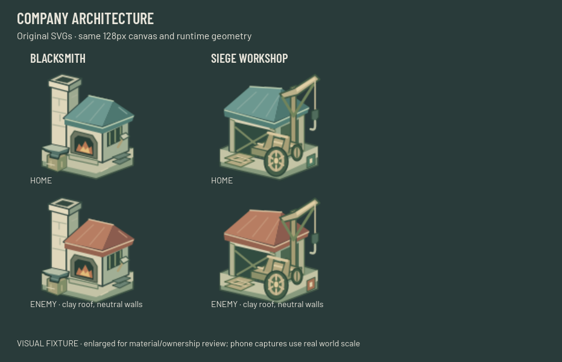
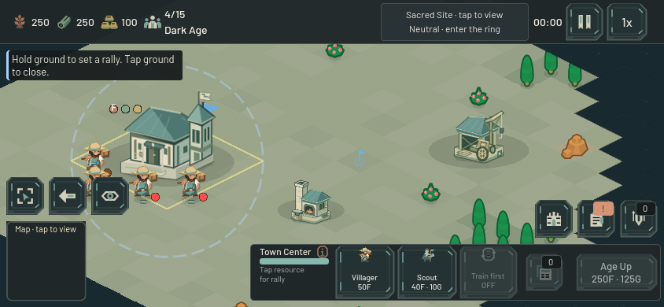

# Company forge and siege yard — 22 October 2026

The Blacksmith and Siege Workshop now have original Company SVGs. These complete the eight principal village families begun in the [first building pass](company_buildings_2026-10-22.md) and [supply/training pass](company_specialist_buildings_2026-10-22.md). Farm and Watch Tower retain their existing vectors.

The **Blacksmith** has an offset limewashed chimney, low mineral roof, deep warm hearth and broad iron anvil. The **Siege Workshop** has an open timber assembly floor, projecting crane with hanging tackle, partly assembled chassis and a large near wheel. The role cues come from practical equipment and different silhouettes, rather than another decorated hall.

The deterministic palette generator now covers eight families. Enemy roofs and cloth change from mineral teal to clay; bone masonry, timber, iron, tackle and ember colors remain neutral. The two team variants retain identical XML geometry and every imported alpha pixel. No raster source was edited or image generation used.

Only four mapping entries changed in `BuildingBase`: two home sprite paths and two material-aware enemy paths. There are no changes to stats, costs, queues, ages, collision, selection rules, simulation or network code. Build cards and placement previews already consume the shared mappings.

| Preserved contract | Blacksmith | Siege Workshop |
|---|---:|---:|
| SVG canvas / import scale | 128×128 / 1.0 | 128×128 / 1.0 |
| Runtime sprite scale | 0.50 | 0.60 |
| Sprite offset Y | −19.2 | −28.8 |
| Gameplay footprint | 2×2 | 3×3 |
| Collision rectangle | 128×64 | 192×96 |

The native Main/GameMap/HUD renders were inspected at **844×390 and 932×430**. At default zoom 0.952, the chimney/hearth and crane/wheel distinguish the two buildings; finer timber and iron details are secondary. Separate zoom-1.6 views keep the tall silhouettes clear of the HUD: [forge](images/company-industry-forge-detail.png) and [workshop](images/company-industry-workshop-detail.png). An independent review of the materials and default phone image found no actionable coherence or readability issue. These are synthetic completed-building visual fixtures, not paid-match or physical-phone evidence. All tests ran from a copied project with a unique user-data directory.

Four focused groups passed without runtime errors or warnings:

1. **Native art contracts:** eight families and both owners; imported dimensions, runtime scales/anchors, footprints/collision, identical alpha, late owner refresh and construction fade. Material sheets and both phone sizes were rendered with Godot 4.6's native Metal renderer.
2. **Facade interaction:** Town Center, Barracks, Camp, Range, Stable, Blacksmith and Workshop through actual viewport touch/mouse at zoom 0.62, 0.952 and 2.2. Nearby unit/resource discovery rings do not steal facade selection; actual bodies, armed destinations and worker construction retain their existing priority.
3. **Replica presentation:** the actual snapshot adapter remaps server owners into local slot-one ownership, reconstructs all eight families plus the legacy Watch Tower, retains construction fade and leaves replicas inert. This fixture does not open a socket.
4. **Paid industry:** an explicit 5,000-per-resource test budget buys every age through age three, pays Blacksmith and Workshop foundations through Main, waits for real worker construction, pays Forge Weapons once and rejects a duplicate charge, then pays and completes a real Siege Engine queue with walkable egress. Worker positions, construction/training progress and completion are not injected. This is transaction/production evidence, not unassisted economic pacing.

Baseline is `1ea5bf06df68b777ab8d3da73723b92d4a3bcd18`. Exact staged file hashes, logs and results are in `output/company-industry-2026-10-22/receipt.json`. The focused files matched their tested copies at receipt time. This pass does not claim a full suite or performance benchmark.
