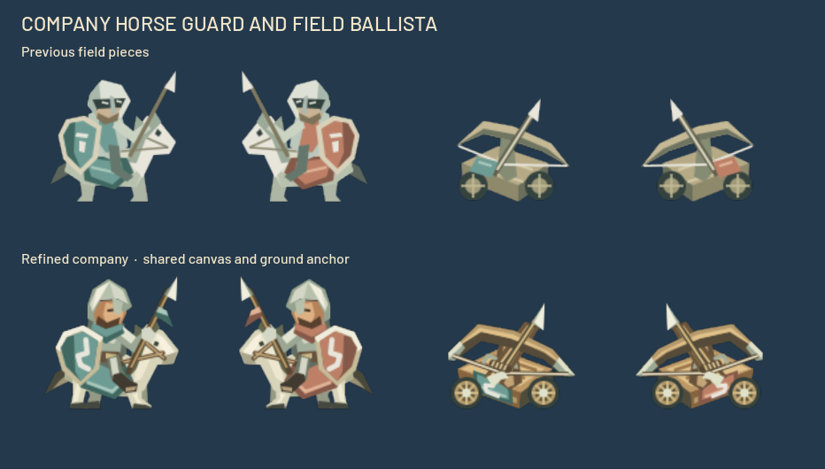
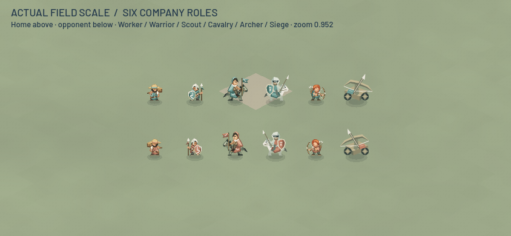
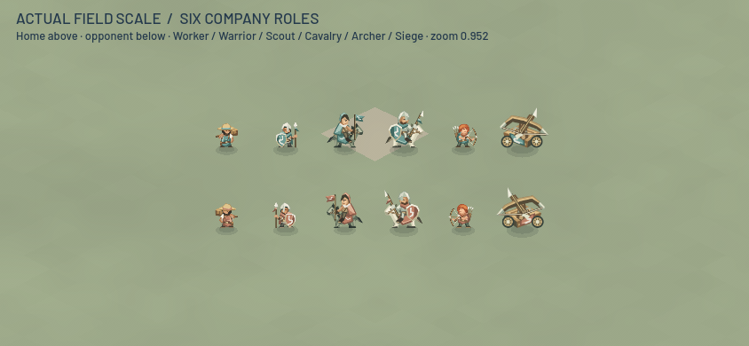
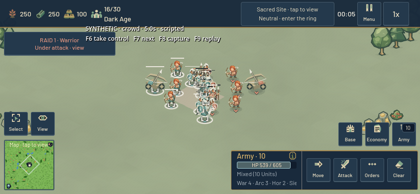

# Horse guard and field ballista — 24 October 2026

The horseman and siege engine now match the established company cast more closely at ordinary phone zoom. The beta.12 crossing capture exposed the older ballista's pale timber outline and small ownership patch; the horseman still had a simplified masked rider beside the more detailed foot troops and Scout.

The horse guard now has an open bone-steel helmet, warm face, leather reins and boot, a pale mount with distinct hooves, and the company's route shield. The ballista has warm timber, dark iron tires, wooden spokes, steel bow tips, a rope windlass and a broader team apron. Both preserve their existing resource paths, 128-pixel canvases, y104 ground anchor and world scales. Their shared HUD textures therefore receive the same art. Worker, infantry, archer and Scout textures are unchanged.

Enemy variants change only the existing three cloth colors. Rendered alpha is identical between owners; 71.85% of fully opaque horseman pixels and 91.75% of ballista pixels remain exactly the same neutral material color. `tools/build_company_unit_palettes.py` regenerates the new pairs alongside the three foot roles.

## Motion and combat boundary

The ballista now rolls with a small 0.35-world-unit vertical motion and slight tilt, replacing its inherited two-unit infantry hop. It recoils along the firing direction after release and settles within the existing 160ms recovery. Other attacking figures anticipate and reach their visual stroke at the existing windup release. Both local units and inert network replicas derive this pose from the already-transmitted animation duration and remaining time.

Only `_update_sprite_motion` and its new pose helper change in `UnitBase`; the other 66 existing functions are byte-identical to `b0e484c`. Attack scheduling, projectile travel, damage, collision, touch picking, selection rendering, cargo presentation, stats and the network packet layout are unchanged. No new sprite nodes or draw operations were added to the unit renderer. The existing framing margins cover the full pose.

## Paired visual evidence

The comparison freezes `b0e484c3de79226d883db89bcc6f8934896172a8` in two private projects. The candidate overrides only the four unit SVGs and `unit_base.gd`; both projects receive identical new fixtures. It intentionally excludes the concurrent building and HUD changes, which the integrated project checks cover separately.

Both 844×390 and 932×430 galleries were inspected at zoom 0.65, 0.952 and 1.6, including both owners, selection, critical health, optional ownership markers, three release-relative poses and a 24-unit mixed formation. At ordinary zoom the pale horse/route shield and timber carriage/round wheels separate the two classes. At minimum zoom, equipment and color masses carry recognition; facial detail is too small to rely on.

The native combat fixture uses the actual Main, GameMap, navigation, orders, HUD and ordinary unit stats. Each owner receives four infantry, three archers, two horsemen and one siege engine; starting economy units are inactive. This is a free, revealed tactical fixture, not paid production or a balance test. The same 20-second sequence includes attack-move, stop, retreat and reengagement.

Both runs recorded the same 106 structured hit records, including simulation time, attacker/defender classes and damage, and the same commands. Both ended with two friendly and one opposing military survivors, with zero navigation failures. This compares the recorded events; it is not a full state or position-by-position replay assertion. Dense melee still overlaps vertically because this pass preserves spacing and navigation.

## Checks and measured counters

All checks passed without engine errors in Godot 4.6 stable, Metal Forward Mobile on Apple M4:

- 288 mirrored attack/selection/touch/framing checks per revision across all six roles and both owners.
- Eight actual release checks per revision across infantry, archer, horseman and siege. Visual advancement alone cannot release damage. The existing windup releases one delayed melee hit or projectile, which resolves the same canonical damage. Baseline and candidate release records match exactly.
- The existing six-role art and network replica suites, repeated attack orders, combat damage and worker cargo presentation checks.
- Both new native galleries and both actual scripted combat runs. Generated Godot `.gd.uid` metadata is included for the two new fixtures.

Fourteen paired gallery snapshots match exactly for draw calls, rendered objects, primitives and scene nodes. Representative whole-scene samples:

| Fixture | Before / after draw calls | Before / after scene nodes |
| --- | ---: | ---: |
| 12-unit roster, 844×390, zoom 0.952 | 39 / 39 | 571 / 571 |
| 24-unit formation, 844×390, zoom 0.952 | 75 / 75 | 607 / 607 |
| Live scripted crowd at 5 seconds | 262 / 262 | 967 / 967 |

These are sampled native render counters, not a throughput or frame-rate benchmark. The combat fixture runs with `--fixed-fps 60` and includes screenshot stalls; its raw callback intervals are retained but excluded from performance conclusions. The texture-memory monitor returned implausible values near 2^64 in both revisions. Those raw values are preserved and excluded from memory conclusions; no cause was established. No physical-phone, browser or capacity guarantee follows from these fixtures.

## Receipts and reproduction

Raw logs, all image pairs, counters, frozen source hashes and release records are under `output/iteration-2026-10-24/unit-art/`. The concise result is `summary.json`; `artifact-receipt.json` indexes the artifacts. `docs/evidence/company-mounted-units-20261024.json.gz` preserves the JSON receipts, test logs and image hashes. Its uncompressed SHA-256 is `93ca4f14c6c34991549ef54e22d01121dc63a2ff3d34e9eb9caebfcddbd1858b`.

Use a source copy with a unique Godot custom user directory, import with Godot 4.6, then run `res://tools/test_company_mounted_art.tscn` headlessly for contracts or natively for galleries. Pass `-- --output=/absolute/output --baseline=/absolute/b0e484c-unit-svg-folder`. Run `res://tools/render_company_mounted_combat.tscn` natively with `--fixed-fps 60 -- --phase=crowd --output=/absolute/output --width=844 --height=390` for the tactical comparison. No online service is required. The fixtures do not save player preferences, and all owned engine processes exited before the integrated checks began.
