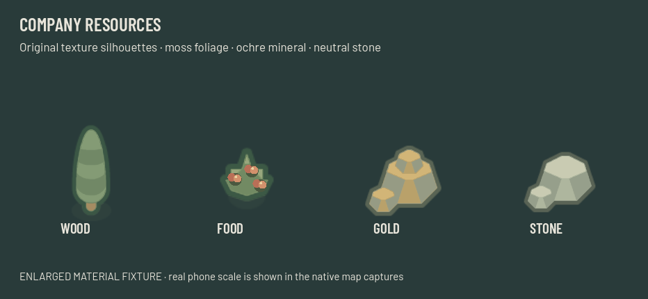
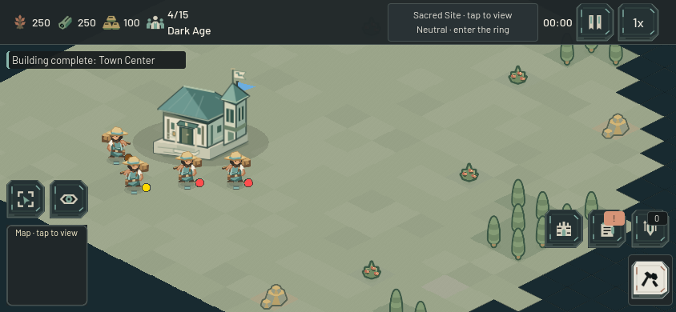

# Company resource materials — 22 October 2026

Resources now fit the village's quieter material palette: layered moss foliage, grouped warm fruit, neutral host rock with ochre gold facets, and warm gray stone. This is a palette pass on the **existing Kenney Medieval RTS textures and silhouettes**, not a claim of new original resource illustrations. The shared shader and paired procedural fruit marks are new. No PNG was edited or regenerated.

`ResourceNode` still loads the same four texture files. Their SHA-256 hashes match baseline `ec6a3da3b656a783038816956d21df0ca5beb302`. The shader changes RGB only, preserving UVs and source alpha, then applies the inherited CanvasItem tint so fog and depletion fades still work. Four cached materials serve the four resource types; there are no new per-resource processing nodes or CPU updates. This is an implementation description, not a performance benchmark.

The original scales remain food 0.64, wood 0.50, gold 0.48 and stone 0.45. Sprite offsets, 16-unit collision circles, resource stock, harvesting arithmetic, navigation and gathering rules are unchanged. Tree canopy picking still reads the original texture alpha. Food clusters stay inside the existing ground discovery radius and do not introduce a new hit mask.

Actual Main/GameMap/HUD captures were inspected at **844×390 and 932×430**, each at **0.65, 0.952 and 1.6** zoom. The fixture waits for resize setup and asserts the actual camera zoom before capture. See the [overview](images/company-resources-overview.png) and [forest/fruit detail](images/company-resources-detail.png). The enlarged material sheet is a visual fixture. The phone scenes use the seeded map's actual resource nodes and current visibility; these are native desktop renders, not physical-phone evidence.

Validation used a copied `ec6a3da` project plus only the resource changes, with a unique user-data directory. This keeps the focused results independent of the terrain/UI edits occurring in the same iteration.

- **Forward Mobile / Metal and GL Compatibility:** the new four-kind fixture passes on both renderers. Every rendered alpha pixel is identical before/after the material; every sampled original canopy mask agrees; inherited tint and half-alpha fading have zero failures. Each type preserves exact extraction amounts, emits depletion once, refuses further harvesting and completes its removal fade.
- **Resource visual targeting:** opaque tree/Farm input, direct food and enemy priority, actual mouse/touch dispatch, hidden rejection and existing Farm guards pass at the existing 0.62/0.952/2.2 zoom boundaries.
- **Resource fog targeting:** automatic discovery, reachable resources, visibility probes, hidden removal and depletion behavior pass.
- **Military/resource touch routing:** Scout and armed Villager routing, Gather/ground intent and selection history pass.
- **Paid production rally:** ordinary 50-food Villager purchases, accepted resource rally, natural harvest/deposit, exact stock accounting, fog and manual overrides pass. This existing fixture advances the paid production queue directly, then steps normal worker gathering; it is not an unassisted pacing test.
- **Paid builder cargo return:** all five existing cases pass, including natural harvesting, paid construction, exact preserved cargo, depleted sources, missing-depot waiting and a paid replacement Camp.

All seven final groups pass without runtime errors or warnings. Initial setup caught a concurrent in-progress terrain snapshot and a test-only texture API assumption; the copy was rebuilt from the committed baseline and the fixture corrected before the final runs. Initial logs are retained separately rather than counted as passing evidence.

Exact hashes, renderer metrics and logs are in `output/company-resources-2026-10-22/receipt.json`, with final native captures under `mobile/` and `gl_compatibility/`. Browser integration and the combined terrain/UI release are separate checks. No full-suite or performance claim is made here.
