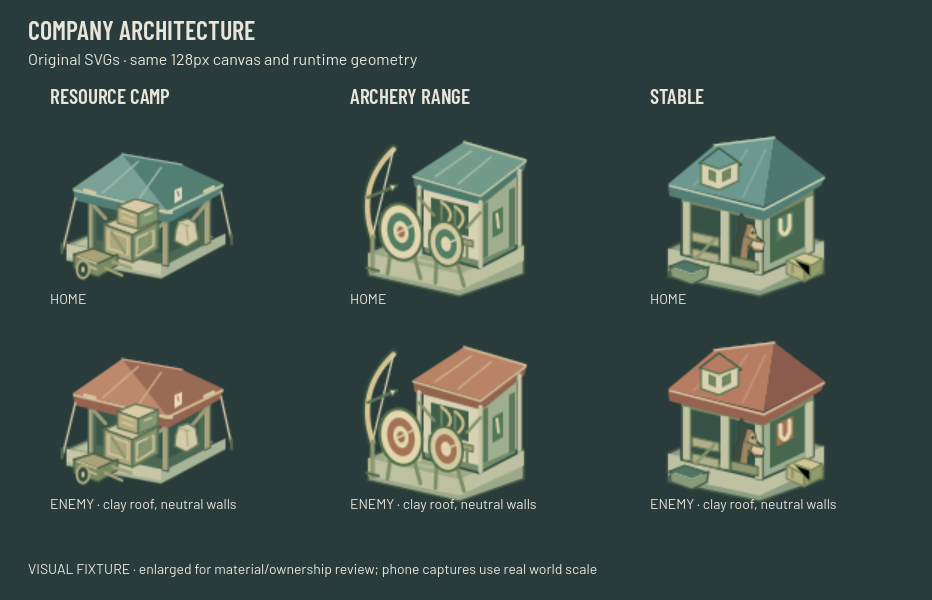
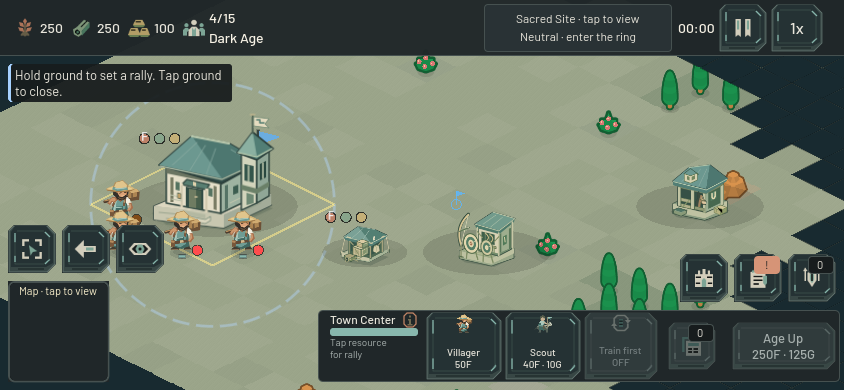

# Company supply and training buildings — 22 October 2026

The Resource Camp, Archery Range and Stable now have original SVG designs extending the Company architecture. They replace three legacy sprites without changing building rules.

- **Resource Camp:** a low open canvas shelter, stacked crates, sacks, tied posts and a small loading cart. Its open silhouette distinguishes it from housing.
- **Archery Range:** a sloping fletchery roof behind two large practice targets, with a tall curved bow marker. The target rings remain readable at default phone zoom.
- **Stable:** a broad open double bay, timber rails, hay loft, trough and visible chestnut horse profile. The horse is a small accent at default zoom; the open stall and horseshoe sign carry the larger shape.

Home roofs and cloth use mineral teal; enemy versions use clay. Bone masonry, wood, canvas sacks, horse and metal retain their material colors. The existing palette generator now covers all six Company families. Regeneration is deterministic; home/enemy XML geometry and every imported alpha pixel match. Blacksmith and Siege Workshop retain legacy artwork and tint.

Only the three sprite mappings and three enemy-variant mappings changed in `BuildingBase`. Build Menu and placement ghosts already read these mappings. No hardcoded HUD paths needed changing, and no HUD or network code was edited in this pass.

| Preserved contract | Resource Camp | Archery Range | Stable |
|---|---:|---:|---:|
| SVG canvas / import scale | 128×128 / 1.0 | 128×128 / 1.0 | 128×128 / 1.0 |
| Runtime sprite scale | 0.45 | 0.55 | 0.55 |
| Sprite offset Y | −19.2 | −28.8 | −28.8 |
| Gameplay footprint | 2×2 | 3×3 | 3×3 |
| Collision rectangle | 128×64 | 192×96 | 192×96 |

[Detail view at 932×430](images/company-specialist-buildings-detail.png).

The native captures use the real Main/GameMap/HUD scene at 844×390 and 932×430, with zoom 0.952 and 1.6. The village is a synthetic visual fixture with completed buildings; it is not paid-match or performance evidence. An independent review alongside the Company units found no concrete palette or silhouette mismatch. The final captures include the refined Builder, Warrior and Archer art, followed by another five-facade selection pass. All runs used a copied project with a unique user-data directory.

Six focused validation groups passed without runtime errors:

1. **Art contracts:** all six Company families, both owners, imported textures, fixed dimensions/scales/anchors/footprints/collision, identical team alpha, late-owner refresh and construction fade; native material/phone captures.
2. **Facade selection:** Town Center, Barracks, Camp, Range and Stable via actual viewport touch/mouse at three zooms, including nearby friendly/enemy bodies, resource discovery rings, construction and armed orders.
3. **Replica presentation:** actual snapshot adapter with slot-one ownership remapping, reconstruction, six Company families and one legacy family, construction fade and inert replicas. This fixture does not open a live socket.
4. **New paid specialist fixture:** an explicit funded test budget buys Feudal and all three buildings through Main. Real workers finish them; exact Archer/Horseman purchases enter real queues and emerge on walkable terrain. No worker position, construction/training progress or completion state is injected. This verifies transactions and production, not unassisted economic pacing.
5. **Paid builder cargo return:** existing five-case regression includes a naturally completed replacement Resource Camp receiving exactly the worker's preserved cargo.
6. **Build-menu placement transition:** preview, explicit paid Place, cancellation/reopening and camera gesture behavior remain intact.

Evidence and exact staged source hashes are in `output/company-buildings-expansion-2026-10-22/receipt.json` with logs and captures alongside. This is focused validation, not a full final-source suite. The visual work uses hand-authored vectors; no PNG source was edited and no image-generation tool was used.
