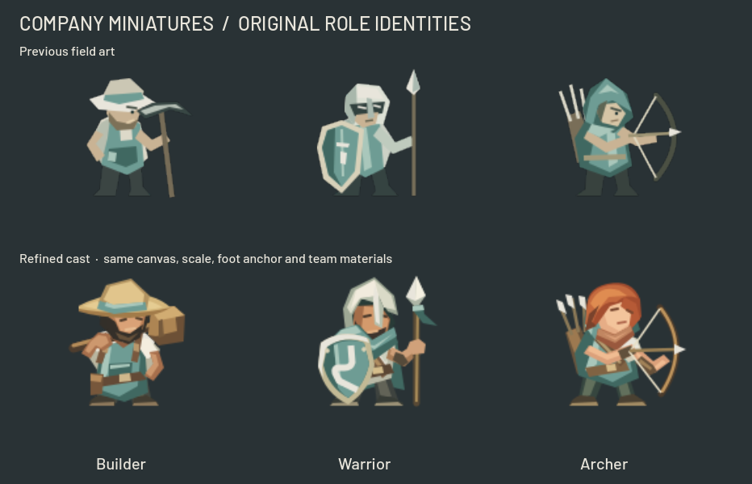
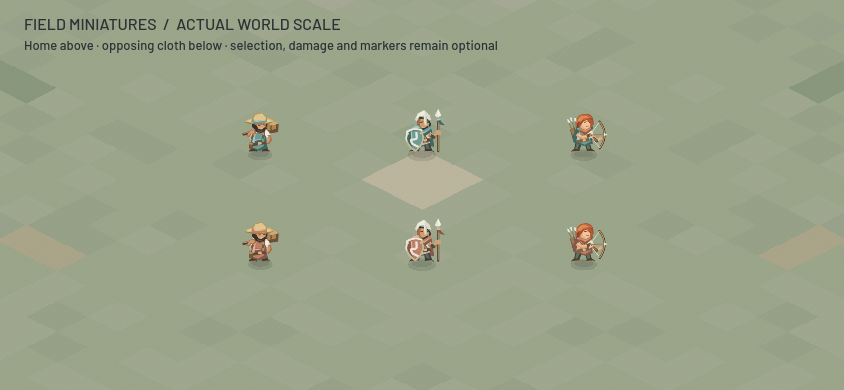

# The company on the battlefield — 22 October 2026

The Builder, Warrior and Archer now share more of the original menu cast's identity at the existing battlefield scale. This refines the established original SVG field pieces; it does not replace Kenney sprites or introduce a second ownership system.

- Builder: warm straw brim with a mineral band, shoulder mallet, rolled linen, leather apron straps and visible bearded face.
- Warrior: bone helmet and beard, folded scarf, spear and a fuller shield carrying the company's route mark.
- Archer: copper hair, resting hood, clay neck wrap, open bow, quiver and a lighter stance.

The three roles retain their existing resource paths, 128px canvases, sprite scales and y104 foot anchor. Existing HUD/recruit textures therefore use the same refined artwork. Terrain, HUD layout, movement, pathfinding, attack timing, damage, unit stats, collision radii, touch-selection logic and visual-bound margins were not edited in this pass. Opaque artwork bounds change with the silhouettes and continue to be measured by the existing framing code.

Enemy variants replace only the three existing cloth colors with clay equivalents. Skin, straw, copper hair, linen, helmet, leather and wood stay neutral. Rendered alpha is identical between owners; 65–79% of fully opaque material pixels remain exactly the same. `tools/build_company_unit_palettes.py` regenerates these three variants without changing other roles or the menu illustration.

## Evidence

The native Godot fixture renders the real unit scenes over the generated GameMap. Both 844×390 and 932×430 were inspected at zoom 0.952, 0.65 and 1.6, plus selected/critical-health/clearer-marker views and an 18-unit formation. The Builder's first draft obscured the eyes under the brim; the final revision raises the brim's front edge and exposes the face. At normal phone zoom the straw hat, route shield and copper hair separate the roles. At 0.65 the large equipment and color masses remain the useful cues; facial detail is not reliably readable.

`tools/test_company_unit_art.tscn` passes all three imported-texture and material contracts, unchanged collision/scale/anchor checks, and 30 pose checks covering mirrored movement, work, attack lunge/recoil, central-body selection and health/visual framing. The native run exited cleanly. The test operates in a private project configuration and never saves player preferences.

`tools/test_company_unit_replica.gd` passes through the actual client match entry and NetworkMatch snapshot adapter. It checks all three roles for both server owners and both assigned player slots, then removes and reconstructs them. Texture paths follow local ownership; neutral materials remain untinted; snapshot attack animation, interpolation and recent-hit feedback advance while simulation remains disabled. This is an adapter fixture, not a public socket test.

Source hashes, material counts and verification details are in `company_unit_art_metrics_2026-10-22.json`. Local native captures and logs are under `output/company-units-20261022/`. The screenshot fixtures do not claim paid production, tactical balance or physical-phone performance. Mounted roles and Siege retain their earlier field art. Dense formations can still overlap vertically; this visual pass does not alter spacing or hitboxes.

## Reproduction

Use an isolated project copy with `config/use_custom_user_dir=true` and a unique `config/custom_user_dir_name`; import it with Godot4.6 before running the fixture. Run `res://tools/test_company_unit_art.tscn` natively for images or headlessly for contracts. Pass `-- --output=/absolute/output/path --baseline=/absolute/previous/svg/folder` to preserve the before/after sheet. The archived comparison uses the six role SVGs from baseline `009bed4`; the comparison sheet is optional when those files are absent. Run the replica check with `--headless --script res://tools/test_company_unit_replica.gd`. No online service is needed.
