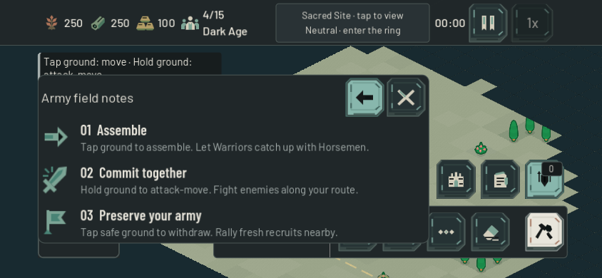

# Fieldcraft — 22 October 2026

Version `0.2.0-beta.5` adds optional Army field notes, fixes a concrete Stand Ground acquisition delay, and completes original art for the Blacksmith and Siege Workshop.

## Army field notes

Army now offers the existing Info control. It opens three short, illustrated instructions: assemble a mixed-speed force before engaging, hold ground to attack-move, and tap safe ground to withdraw. The first instruction follows the [paid tactical comparison](paid_tactical_plans_2026-10-22.md), where one staging order materially improved the same mounted roster. It is advice about a useful choice, not a promise that staging always wins.

Info replaces the group actions within the same sheet. Back restores them; closing or switching surfaces resets to actions. The page does not change selection, orders, resources, unit speed, formation rules or optional battle-lesson progression. It is available on demand in solo and online play, without a new battlefield banner. The three existing custom command glyphs and compact heading/body hierarchy keep the instructions legible.

Twelve native phone/scale profiles pass actual engine ScreenTouch routing: 844×390 and 932×430, three scales, with plain or synthetic-notched safe areas. All three instructions fit without scrolling. Info/Back/Close/surface switches preserve selection and banks and leak zero world orders. Repeated live snapshots preserve the page and its geometry. Opening guidance stays hidden, and both raid locations remain reachable. Native natural-layout cases do not force per-frame layout; only the six synthetic-notch cases supply the imaginary inset.

The first-open Economy/Train/Info check and the four guide/raid-priority touch journeys pass. The full paid management journey passes twelve phone profiles plus a separate 550×338 logical stress case: paid training/refunds/Repeat/rally, worker reassignment and both saved groups remain functional. Its first run correctly exposed obsolete test expectations for the former flat button styles. The test now verifies the specific custom pressed/focus SVG textures and existing selected-text contrast; no production theme change was made to satisfy it.

Evidence: `output/army-field-notes/`. The fixtures hold AI/economy where necessary and the broad management fixture advances production for setup; this is interface/transaction evidence, not full-match pacing or physical-phone certification. Existing ordinary toasts can still sit partly behind management; urgent raid cards have their separate reachable lane.

## Combat and architecture

The [Stand Ground receipt](stand_ground_2026-10-22.md) records 146 focused before/after assertions. Both automatic acquisition paths now use stationary engagement reach. A moving enemy that previously triggered a false target/ignore cycle takes its first hit at 0.80s rather than 3.65s in the controlled arena, with no guard movement or range increase. Direct attacks, attack-move, patrol, retaliation, fog and existing damage/weapon rules remain intact. The paired paid-map comparison is recorded separately; faster valid acquisition can change later damage and survival, so the fix is not described as balance-neutral.

The [industry-art receipt](company_industry_2026-10-22.md) covers original forge chimney/hearth/anvil and workshop crane/wheel silhouettes, neutral materials with teal/clay ownership, native phone rendering, actual facade input, snapshot-adapter reconstruction and paid construction/research/Siege production. Building footprints, anchors, collision and costs remain unchanged.

The actual exported browser preview was inspected at 844×390, DPR3, Extra Large interface size and asymmetric synthetic safe insets. The canvas fills its viewport; Army Info/Back/Close and guide restoration fit. No engine/script error appeared. Local Python hosting has no diagnostics POST endpoint and returned expected 501 responses; the clean public build receives its own verification after publication. Captures: `output/playwright/fieldcraft-preview-*.png`.

The [paired paid regression](paid_tactics_boundary_regression_2026-10-22.md) compares all fifteen engagements with identical paid openings and controlled deployment. First damage matches in 15/15 cases; no navigation failures, stalls or unanswered orders occur. Later damage and survival do change, including a staged mixed force that no longer wipes its defender. The three slower-learner Easy matches remain honest paid Sacred victories: Plains 659.90→703.13s, River 735.43→670.67s, Woodland 677.28→677.28s. None applies an economic bonus; learner workers and Town Centers take no damage. These fixtures support release without establishing human balance.
