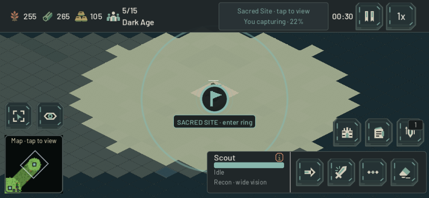
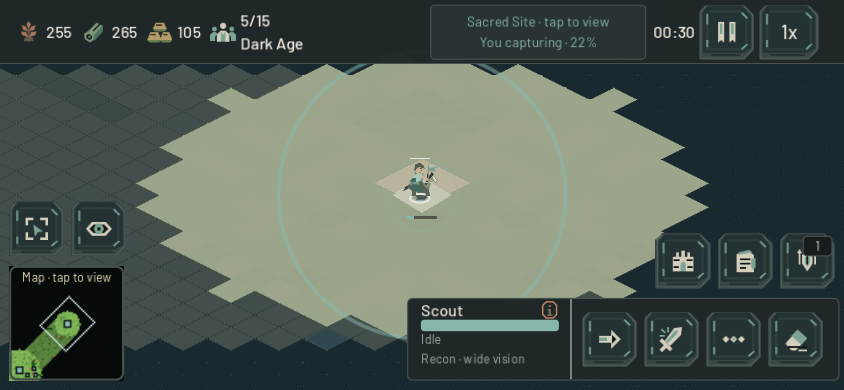
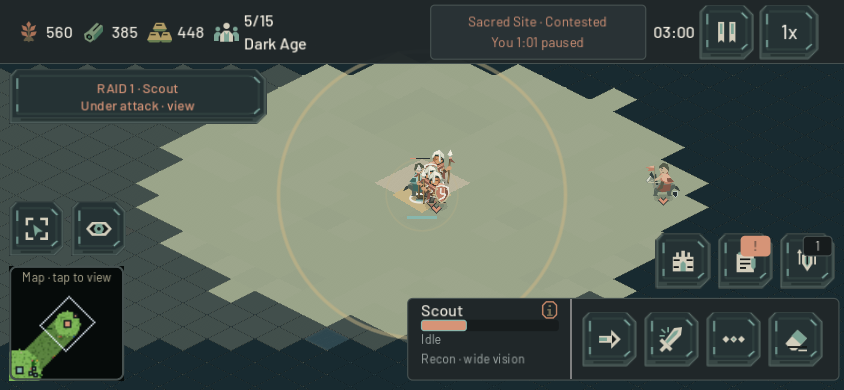

# Hold the site — 22 October 2026

Beta.7 gives Easy a limited response to an early Sacred claim and clears an opaque badge that covered the units fighting at the center. It preserves the five-minute ordinary base-raid grace, the 6:30 neutral-site initiative, small paid squads and the 45-second regroup after a field loss.

## An objective fight worth reinforcing

A natural paid Scout opening exposed a timing gap: on all three seed 101 maps the Scout completed training at 8.02s, entered the capture ring at 23.42s, claimed at 53.45s and won at 233.45s without damage or contest. Easy saw it around 42s and already had three normally paid Warriors by 102–114s, but an unconditional 300s guard held both recon and fighter response back. A complete public browser match independently reproduced the issue with a later purchase, winning at 4:30 with one Scout and zero losses.

The two guards now share a data-driven 150s reactive threshold. Existing policy still requires a hostile public claim, active contest or visible nearby enemy before the neutral initiative opens. Hidden units are not revealed or targeted through ownership. Production, gathering, costs, damage and movement are unchanged. The earliest pilot is contested around 172.76s, leaving about a minute before its old victory; this is a limited paid response, not an accelerated base raid. See the [paid opening comparison](easy_sacred_response_2026-10-22.md) for the final map/seed and reinforcement matrix.

The [independent paired regression](easy_response_regression_2026-10-22.md) retains three slower-learner victories, with natural losses and paid replacements. First contact moves earlier by 2–21s, while no learner worker, Town Center or home-area damage occurs in those three cases. Outcomes change substantially; the result does not establish human beginner balance. Two Medium/Hard controls match every behavioral JSON field exactly. Five author-focused suites plus two independent reruns cover timing boundaries, fog, shared squads, regroup, home defense and the existing paid Siege exception, with no errors or warnings.

## Let the fighting units show

The public screen-space Sacred badge previously painted an opaque 46px disk over any unit at its center. Native paid play made the problem obvious:

The map annotation still draws its public capture ring. Its badge and caption now appear only while the center tile is outside current local vision. When the ground is visible, the underlying marker, units and health bars remain readable and the top Sacred control still carries progress and focus. Losing vision restores the badge, including an owned but merely explored site. This reads only the player's current tile visibility and public objective location; it does not inspect hidden actors or change touch routing. Online replicas already remap their local player to 0.

Four native phone profiles (844×390 and 932×430, Standard/Extra Large) compare actual pixels against the same controlled scene with the annotation hidden. Sixteen old occlusion failures become zero. In every visible/re-visible case, all center and caption pixels exactly match the unobscured reference; the ring remains drawn. Unseen and owned-explored cases retain the badge and label. The fixture controls unit positions and fog refresh to isolate presentation; it is separate from the naturally paid gameplay observer. Public status and input transparency also pass, as do the existing notification and guide/raid-priority journeys.

Two discarded fixture drafts are retained locally: the observer initially re-enabled itself during the reference capture, and an oversized caption sampling region included the preserved ring. The final fixture freezes the visual observer during paired capture and samples the ring independently. No application workaround was needed. Evidence: [native metrics](hold_the_site_native_metrics_2026-10-22.json), `output/sacred-annotation/`, its source receipt and `tools/test_sacred_annotation_visibility.gd`.

The native paid observer uses the same normal Scout purchase and Move as the baseline policy, with only camera/viewport presentation controlled. At 3:00 the candidate shows a damaged Scout and three paid Warriors in the contested ring; the baseline has no opponent there. These are fixed-step native rendering checks, not phone performance measurements. The native candidate reaches its 480-second observation limit without a winner; its first contest is 172.78s. The baseline wins at 233.45s. Both complete without fixture failures.

A fresh exported Chromium touch session uses 844×390 CSS pixels, DPR3, Extra Large controls and synthetic left/right/bottom insets 53/24/21. Through actual menu and touch controls it selects River Crossings / 101, buys a Scout for 40 food and 10 gold, sets a Sacred rally and observes the unobscured unit. At 5:26 the Scout is gone, the old automatic win has not occurred, and the badge has returned over explored ground. The partial match exits through Pause. It does not establish exact browser counterattack timing; that is measured by the paired native/headless observers. The development static server reports expected diagnostics POST 501s and three software-renderer readback warnings, with no engine errors. Local captures: `output/playwright/hold-preview-*`. The published verification follows below.

## Published verification

The clean beta.7 runtime `2ab5c416cd4c` is live at https://game.4mn.org with source SHA-256 `9daf824730f954187ab94ab21af12067ec1114d2273b0e85aef3f7e6c0fc6976`. Two independent closed exports reproduce the substantive payloads and source manifest. Game and match containers restarted after an immediate zero-client check; the healthy collector and tunnel retained their exact identities and start times.

A separate fresh public touch session verifies that exact loaded/served identity, full 844×390 canvas, Extra Large controls and synthetic 53/24/21 cutout insets. Through ordinary controls it chooses Easy/Standard, River Crossings / 101, explicitly disables the opening guide, buys a Scout and sets its Sacred rally. The visible Scout is unobscured. At 2:45 it holds with 1:25 remaining; at 3:05 it is lost, Sacred is contested and its clock is paused at 1:18. Losing vision restores the public badge. The match reaches 4:20 without the former automatic win, then returns through Pause to the menu. Zero console errors; two software-renderer readback warnings. This corroborates the response and presentation on the published Web build; exact first-contact timing comes from the paired simulation observers. Receipt: `output/hold-site-public-browser.json`.

All 40 public payloads and 13 private-path checks pass. The exact-commit public WSS suite passes ten cases, including normal paid economy and authoritative replicated combat; zero runtime errors, three existing cleanup warnings. All clients close, all 1,278 source hashes stay unchanged, and the live server has no established match connections or runtime errors at postflight. See [deployment](debian_game_deployment.md) for the exact release and rollback receipts.
