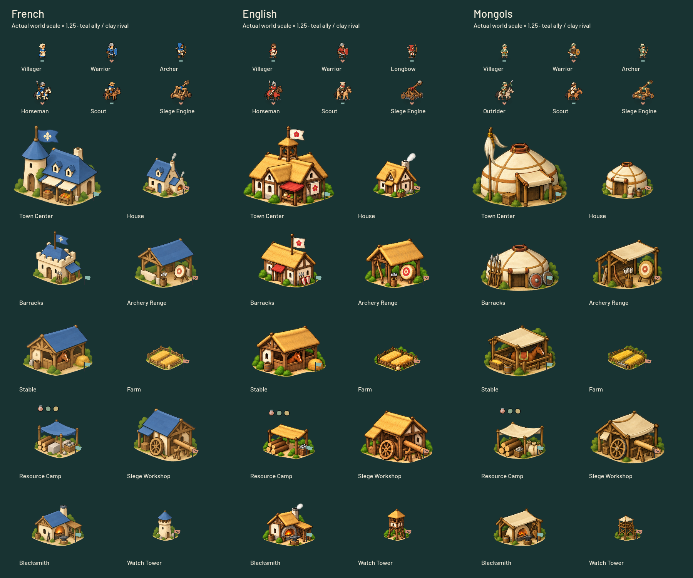
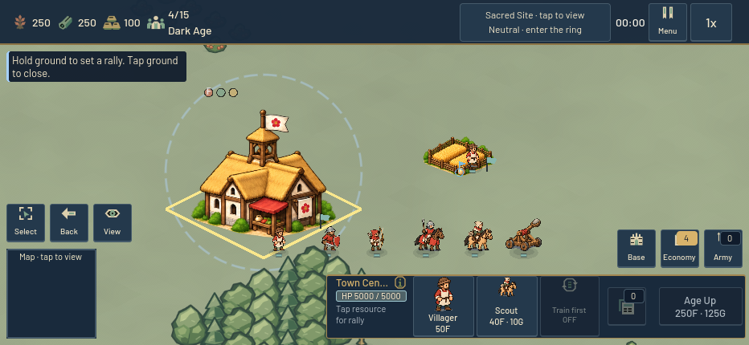
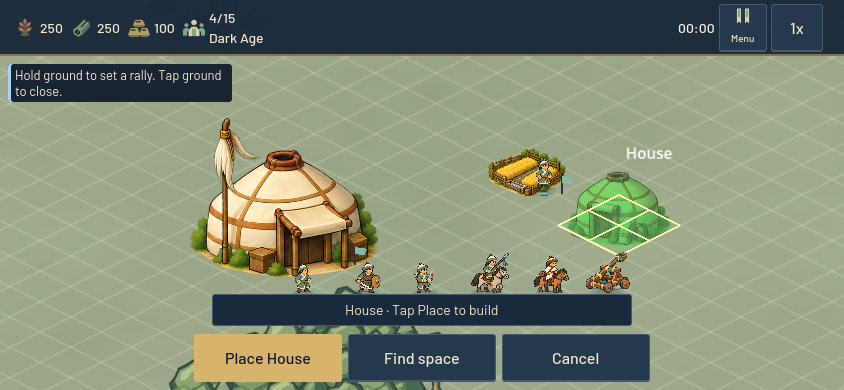
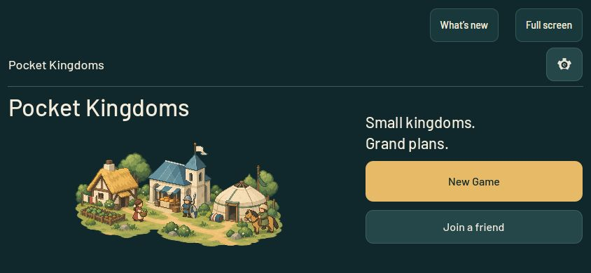
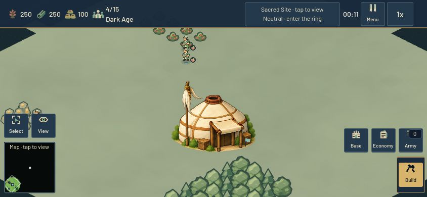

# A gentler little world — beta6

The owner requested a bounded redesign of every civilization asset to match the landscape: soft color, rounded silhouettes, painterly texture and restrained detail. This release replaces the glossy miniature presentation with 18 unit illustrations, 30 building illustrations, three native vector crests, a painted menu/welcome scene and a softer app icon.

## Identity and balance

| Stable ID | Display identity | Art direction |
| --- | --- | --- |
| 0 / crownlands | French | Warm limestone, muted blue slate, coifs and padded coats, simple fleur-de-lis |
| 1 / verdant | English | Cream plaster, timber, ochre thatch, madder cloth, yew longbows, rose |
| 2 / sunstride | Mongols | Ivory felt gers, sage deel robes, ochre ties, stocky ponies, horsehair standard |

These are stylized historical inspirations, not a reconstruction of one precise date. The Mongol farm is a cultivated frontier grain plot; it preserves the game's existing food-building role. Everyday equipment and architectural silhouettes carry identity without ornate fantasy fittings.

Numeric civilization IDs and all bonuses are retained: French occupy the balanced original slot; English retain wood gathering and Longbow tradeoffs; Mongols retain food gathering, Outrider and building-HP tradeoffs. Unit/building costs, collisions, damage, speed, windup, gathering, maps, AI and victory rules are unchanged. Network protocol 4 and map catalog 3 remain unchanged.

## Shared assets and movement

The existing KingdomArt catalog feeds battlefield sprites, HUD portraits, recruitment cards, construction cards and placement ghosts. New atlas regions retain bottom/ground anchors and aspect ratio. The worker sprite has empty hands so the runtime can supply an axe, hoe, pick or hammer. Feet stay planted during work; tool rotation and compression track the body's pose. Walking, melee, bows, riders and siege recoil are restrained to suit the larger illustrated shapes. Accessibility settings remain honored. These are procedural poses, not frame-by-frame animation sheets.

Assets were produced with the built-in image_gen tool using the game's landscape as a style reference. Generation prompts are retained in `docs/illustrated_civilizations_prompts_2026-10-24.json`. Original generated pixels/alpha are preserved in the six sheets and hero. Reviewed alpha bounds and source hashes are recorded in `assets/kingdoms/atlas_layout.json`; `tools/prepare_kingdom_atlases.py` reproducibly writes all 48 texture resources and the manifest.

## Verification and publication

Verified implementation checkpoint; matching publication is recorded below:

- Clean Godot 4.6 import.
- Fifteen distinct focused regression cases passed across the initial and affected-case runs: all 48 catalog sprites (1,178 checks), unit actions (402), civilization rules/menu, phone menu/reflow, combat damage/timing, gathering/dropoff, AI economic investment, Sacred state machine, online unit/building replicas, recruitment and selection geometry (848).
- The initial production test exposed tall portrait icons expanding the 80px dock to 94px. Recruitment now fits icons in both axes. The final production test passes eight screen/scale profiles; the four affected final suites all pass. This is a presentation fix, not a queue or economy change.
- 26 Web shell/export-wrapper tests passed.
- 27 native GL-compatibility phone captures passed at 844×390 and 932×430, covering each civilization on actual terrain, work/combat phases, recruitment, construction previews and building cards. All 48 sprites and ten action rows were also reviewed in native rendered galleries.
- A military fixture now explicitly selects baseline civilizations before asserting baseline cavalry HP; previously saved preferences contaminated that test. Attack logic was not changed.

The art review corrected overlapping atlas rows and strengthened the initially faded English/Mongol unit rendering. No final crop contains a neighboring sprite. No gameplay balance values changed. The matching Web/server build, restart and public-browser results follow below.

 `tools/capture_illustrated_civilizations.tscn` captures the actual main scene, terrain, unit/building resources, recruitment HUD and placement preview at 844×390 and 932×430. Its staged/frozen actors are visual evidence, not a paid-gameplay or physical-device performance claim.

Scope is deliberately bounded to this presentation pass. The known late idle-browser WebGL error, physical-phone performance and full-match pacing remain separate follow-ups.

## Published checkpoint

**Live:** `0.3.0-beta.6`, runtime source `a1aabfeb94fe0629f46fba82f6643a9856c91a32`, at `2026-10-25T03:13:20.742562+00:00` (October 24 local client date). The source checkpoint was pushed to GitHub before building. Canonical and independent Web exports matched. The isolated Linux smoke passed, and guarded activation restarted only `aoem-online` after observing zero active/closing connections. Beta5 remains available for rollback. Public HTTP and active-server postflight passed for 925 runtime files. Later publication documentation commits do not change the packaged runtime.

- Release: `v030beta6-a1aabfeb94fe-90136bbe63-a56bbb6f91`.
- Web manifest: `90136bbe63097d02a242cadb7100dadc05e9f4ea61e2f63d6a4461796a18c7da`.
- Server manifest: `a56bbb6f91d47ff80249bc09996f8b6bb936774e49e70200bba426a1f7a13336`.
- Activation receipt: `/home/ben/aoem/deployment-backups/v030beta6-a1aabfeb94fe-90136bbe63-a56bbb6f91/activation.json`.
- Compact verification receipt: [beta6 evidence](evidence/beta6-illustrated-release.json).

At 844×390, the committed browser build passed normal setup/selection, English startup, paid Villager recruitment, paid Farm placement and completion, and resource gathering. The public site passed normal Play/update launch, the new illustrated menu, Mongol selection, normal skirmish startup and main-menu return. No warnings/errors were captured during these bounded browser journeys. The original public English preference was restored after the test. Static galleries additionally cover all work/combat poses and the two phone sizes; they do not establish frame-by-frame animation quality or real-device performance. Physical-phone performance and long-session behavior remain untested in this pass.

Historical reference points: [BnF fleur-de-lis armorial](https://expositions.bnf.fr/livres/armorial/grand/ars_4790_047v.htm), [English Heritage medieval warfare/longbows](https://www.english-heritage.org.uk/learn/story-of-england/medieval/war/), [Metropolitan Museum Mongolian tent](https://www.metmuseum.org/ko/essays/the-mongolian-tent-in-the-ilkhanid-period), [Royal Armouries Mongol equipment](https://royalarmouries.org/objects-and-stories/stories/the-mongols/arms-and-armour-of-the-mongol-empire). The English rose is this game's company badge, not a claim that every English army used it.
