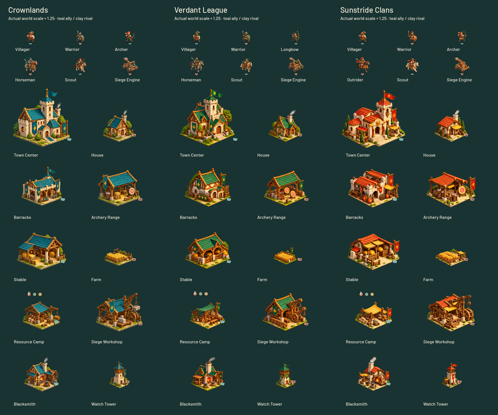
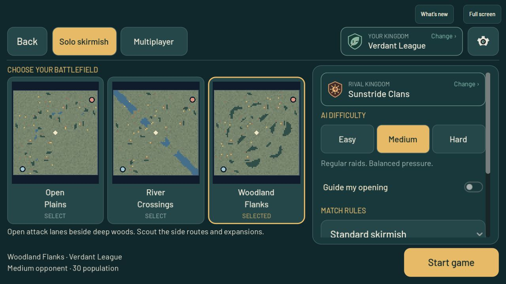

# Pocket Kingdoms miniature art refresh

The owner requested that the new menu illustration's modern, approachable but serious miniature style extend to every unit and building in all three civilizations. This is version `0.3.0-beta.4`, protocol 3. Publication and checks are recorded below.

## Included presentation

Each civilization has artwork for Villager, Warrior, Archer or Longbow, Horseman or Outrider, Scout and Siege: eighteen unit sprites total. Each also has Town Center, House, Barracks, Archery Range, Stable, Farm, Resource Camp, Siege Workshop, Blacksmith and Watch Tower: thirty building sprites total.

| Civilization | Visual identity |
| --- | --- |
| Crownlands | Teal cloth and roofs, pale limestone, steel and honey-gold details |
| Verdant League | Forest-green cloth and roofs, oak framing, leaf fittings and lighter equipment |
| Sunstride Clans | Terracotta and saffron cloth, sandstone, bronze sun details and airy shelters |

The shared catalog selects art from the actual player's civilization. The battlefield, recruitment portraits, building cards and placement previews share those resources. Ownership marks remain distinct from civilization decoration. Unit movement/work/attack poses and building construction reveal use the existing runtime systems. Combat statistics, costs, collision footprints, rules and network protocol are unchanged.

New Game displays the player's named kingdom and crest with a Change action, and a separate rival choice for solo play. The menu and comparison sheet use clearer Barlow headings, evergreen panels, warm ivory text and honey-coloured actions. The browser welcome page uses the same illustration and palette. The old animated atlas/portrait menu composite is replaced with static art.

## Asset source and reproducibility

The built-in imagegen tool produced the hero and six transparent atlas PNGs. The original generated pixels are preserved. `tools/prepare_kingdom_atlases.py` creates AtlasTexture resources and `assets/kingdoms/atlas_manifest.json`, recording source hashes and selected regions. Region inspection is necessary because generated sheets do not guarantee exact cell placement.

The generation prompt set is retained in `docs/kingdom_art_prompts_2026-10-24.json`. The common art direction is premium 3D tabletop miniatures with chunky adult proportions, recognizable medieval equipment, warm upper-left light, softly sculpted materials and crisp silhouettes. The hero is `assets/ui/kingdom_company_v2.png`; the unit/building sheets and per-role resources are under `assets/kingdoms/`.

This adds illustrated sprites to the existing 2D game. It is not a new 3D engine or a frame-by-frame character animation system.

## Validation before publication

- Clean Godot 4.6 import; all 1,178 miniature catalog, source-region, ownership, placement and rendering checks passed.
- Civilization setup: 468 checks passed, including independent player/rival drafts and phone safe areas. The fixture now keeps its simulated platform geometry through actual modal-close callbacks.
- Phone menu layout: 2,168 checks passed; menu mode transitions: 1,304 checks passed.
- Actual network snapshot unit and building replica fixtures passed, including both local slot mappings, construction reveal and completion cleanup.
- Web shell artifact tests: 18 passed; Windows export wrapper tests: 8 passed.
- Reviewed the native 48-sprite gallery; committed-build and publication results follow.

## Published release

**Published:** `0.3.0-beta.4`, source `005aa4b87b9a0c592ae0d73588a1e50c01669d56`, protocol 3, at 2026-10-24T21:39:07.064878+00:00. The canonical and independent Web exports matched. The isolated Linux server smoke passed; guarded activation restarted only the dedicated game service and switched the static release. Public HTTP and active-server verification passed for 923 runtime files. Beta3 remains available for rollback.

The local browser preview passed at 844×390: New Game, kingdom comparison, selection/confirmation, Sunstride match startup and menu return. The public browser loaded the updated welcome screen and menu, displayed the selected kingdom in setup, and started a Verdant match with the new artwork. These are bounded startup/presentation checks, not long-session or physical-device acceptance.

- Release identity: `v030beta4-005aa4b87b9a-78cabe46fa-d72416a4eb`.
- Web manifest SHA-256: `78cabe46fa85308aeb3145fc8ba353bd34301b7ac066977e975861fb5fc7525a`.
- Server manifest SHA-256: `d72416a4eb97d3a0a481ce63a6f4445dc9f6775d2befa56d557d936396cfc559`.
- Activation receipt: `/home/ben/aoem/deployment-backups/v030beta4-005aa4b87b9a-78cabe46fa-d72416a4eb/activation.json`.
- Local build/smoke/activation/postflight/browser evidence: current chat `work/beta4-kingdoms-20261024/` and `outputs/`.

## Remaining work

The long idle-browser `RangeError: Invalid array length` is still open. Its retained stack reaches Emscripten's WebGL object generation, and the shipped glue contains a monotonically increasing GL object table ID. That is a lead, not a proven root cause. No unverified third-party buffer-recycling patch was applied. Related upstream report: https://github.com/emscripten-core/emscripten/issues/22425.

The terrain, in-match HUD and pause/settings panels retain earlier presentation and are candidates for a separate coherence pass. Continue with physical-phone readability and performance checks, a bounded investigation of that error, and attentive match pacing/recovery evaluation. The rejected six-minute scoring delay and protocol 4 experiment remain excluded. See [the recovery handoff](recovery_handoff_2026-10-24.md).
