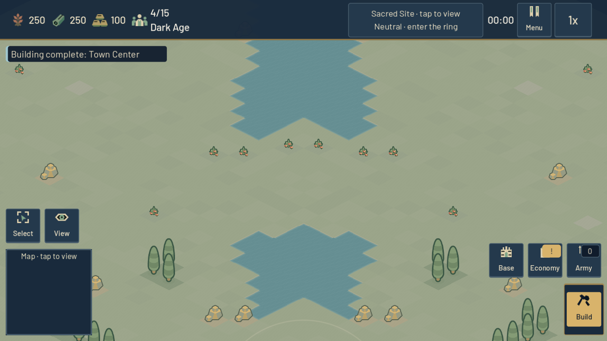
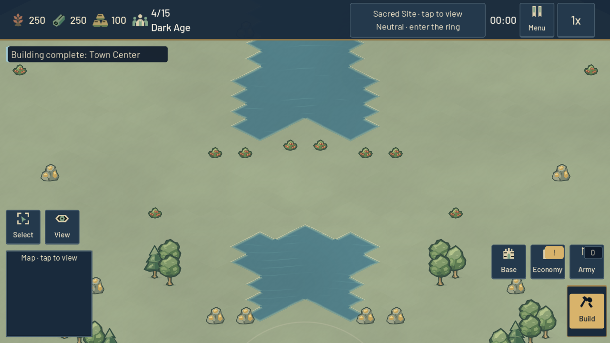
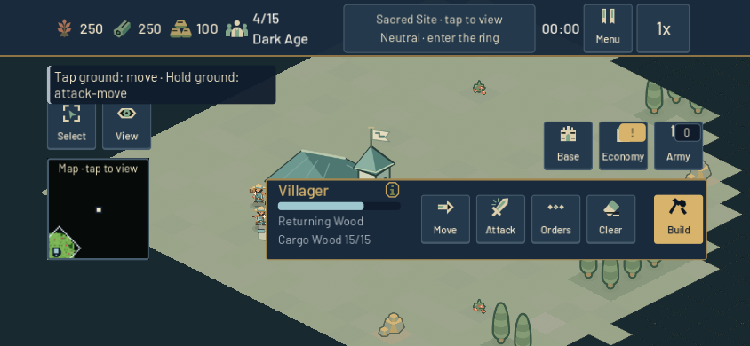
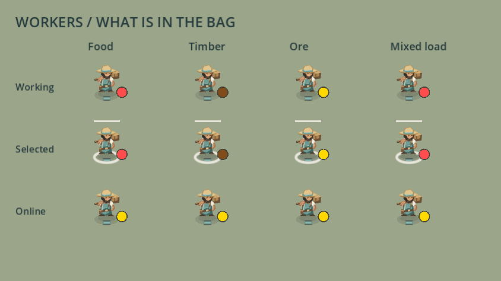
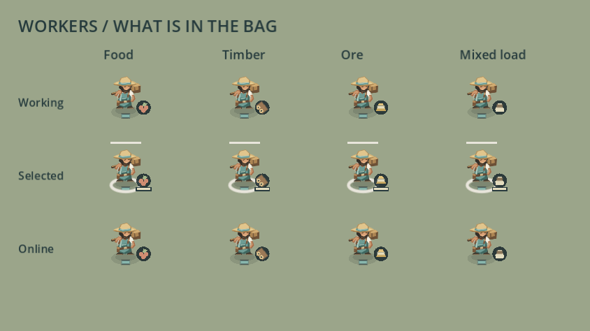
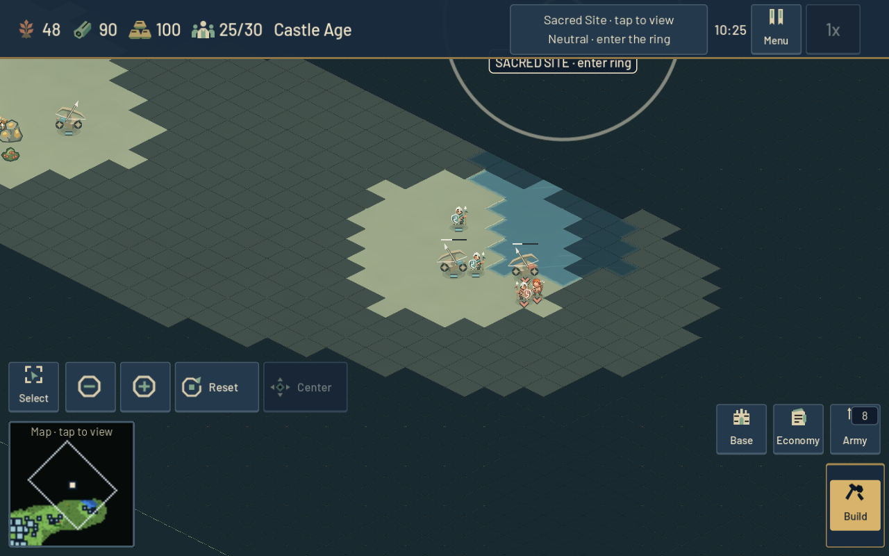
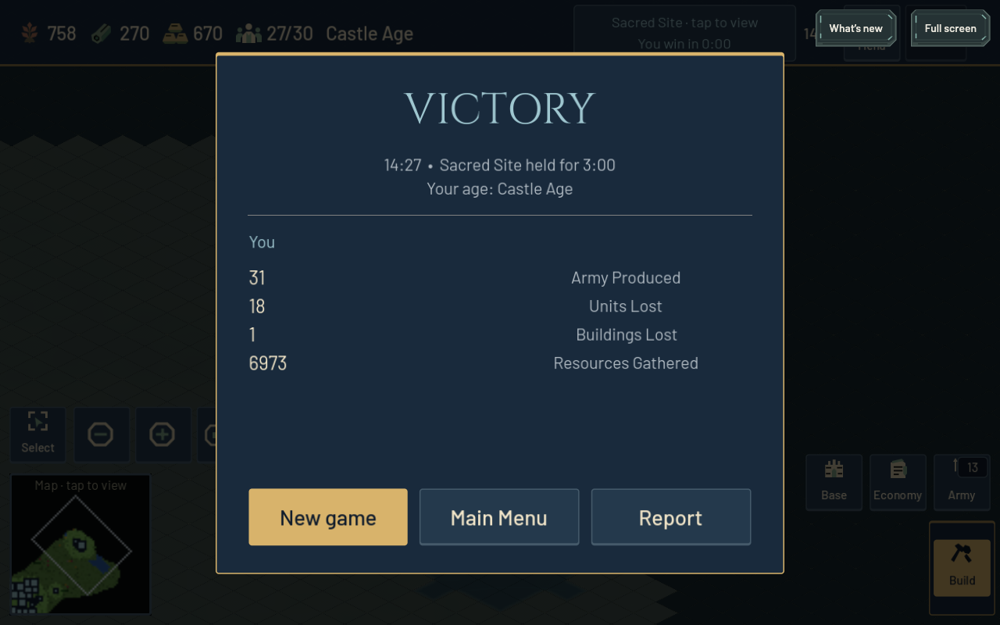
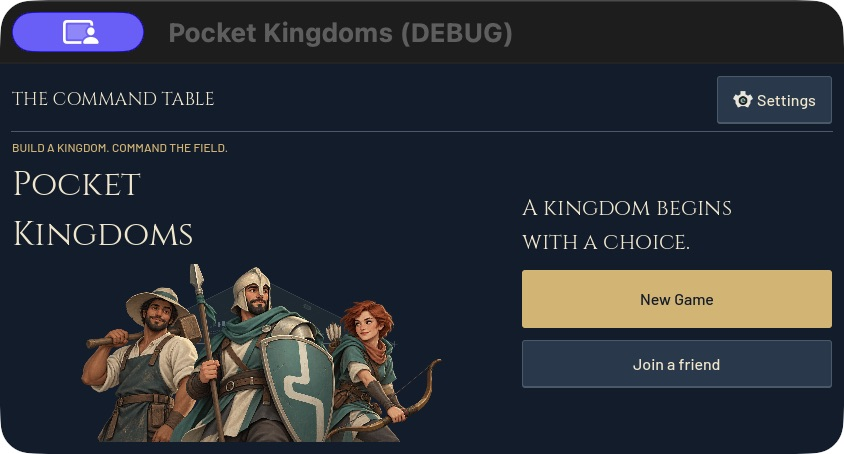

# Living battlefields and clearer orders — 23 October 2026

Beta.12 is published at [game.4mn.org](https://game.4mn.org), with richer terrain/resources, explicit selection information, correct worker cargo and lower measured authority costs. Runtime: `7681103e077ce404d0741c178b21491b972bf6ed`. Work began from clean `c864169`, after read-only verification of public beta.11 and its server. Existing work and player preferences are preserved.

Accepted commits: `724bafd` field art; `b76a87b` selection/economy clarity; `755abf6` authority costs; `317959c` cargo/redraw; `7681103` release metadata; `b68ad15` fixture repairs. Later evidence/documentation commits do not change the deployed runtime.

## Baseline and working loop

A fresh headed Chrome client played a short River opening: gathering/delivery, paid H/Q training, B construction and pause. Screenshots and source receipt are in `output/playwright/iteration-baseline/` and `output/iteration-2026-10-23/baseline.json`; this was not a completed match.

The baseline exposed identical capsule trees, square resource beds, repeated meadow tiles and bright cargo dots. Selection also mislabeled stock/capture as health, omitted Farm assignment status and falsely warned about missing builders on online replicas. Four independently reviewed batches address these issues and authority costs. Engine windows were serialized, with performance isolated from functional/rendering checks.

## Accepted changes and evidence

### Field art

Original oak, elm and pine silhouettes, grounded resource illustrations, continuous meadow detail and deeper water replace repeated trees, resource-bed squares and flat terrain. Ground anchors/proportions remain unchanged; deterministic tree variation consumes no simulation RNG. Picking follows visible artwork.

Separate shadows added 421 nodes and 105 draw calls in one fixture and were rejected. Baked shadows restore node counts. Eighteen paired views cover three maps and two sizes, with unchanged geometry. Seventeen have equal/fewer draws; the revealed Woodland phone route rises from 88 to 118. These are counters, not FPS. [Field art evidence](world_field_art_2026-10-23.md) includes 37,223 terrain assertions and resource/input preservation checks.

| Before | After |
| --- | --- |
|  |  |

### Selection and economy feedback

Meters distinguish HP, stock, construction and capture. Local Farms show assignment; online/enemy Farms show capacity because assignments are undisclosed. Online foundations no longer falsely say “Needs builder.” Population feedback distinguishes occupied slots, paid reservations, housing and match limits.

Rejected pale fills now provide at least 5.07:1 contrast. A two-pixel height regression was removed, preserving the 80px dock. The final native/headless fixture passes 440 checks; five compatibility suites passed before the final caption adjustment. [Selection evidence](selection_state_clarity_2026-10-23.md) records safe-area scope and failed attempts.

| Before | After |
| --- | --- |
|  |  |

### Worker cargo

Berries, timber, ingots and a mixed-load satchel replace saturated dots; selected workers show fullness. The marker reads actual cargo without mutation, including online replicas, so retasking preserves load identity. Thirty-one contracts cover mixed/legacy loads, retasking, bounds and death. Review caught stale art after an unselected worker harvested a second resource. Harvest now queues a redraw: 39 native checks pass, while removing that call fails exactly the new redraw assertion. Integrated gathering, Farm, traffic and replica checks pass.

| Before | After |
| --- | --- |
|  |  |

### Authority costs

Targeting now rejects distant candidates before expensive fog queries. Snapshot serialization builds a fresh visibility batch within one synchronous call; gameplay queries stay live, with no persistent visibility cache.

Four alternating constrained containers on the Linux host measured 49 target queries at 390.6/396.2ms before and 8.58/8.68ms after; slot-one snapshots fell from 72.3/70.4ms to 18.1/18.5ms. Full dictionaries and target choices match original oracles across 115,323 assertions per candidate. This reconstructed paused roster is not an order replay or whole-match speedup. See [authority profiling](authority_performance_2026-10-23.md).

### Combined verification and publication

Ten final headless suites pass across cargo, replicas, Farms, traffic, placement, combat and menus, with zero errors/warnings. Combat has 22,007 assertions; direct-entry/phone menus have 1,304/2,168. Earlier receipts remain.

One isolated native pair used the same paid roster policy, seed, 844×390 viewport, Apple M4/Metal and normal VSync. Focus, payment/roster, dense-sample, camera and game/wall-clock gates pass. Across 30-second windows, median cadence is about 16.67ms. Dense-active p95 changes 17.318→17.146ms and p99 19.639→19.991ms; whole-window p99 changes 20.723→21.565ms and p95 draws 229→224. Dense coverage is 7.93/7.63 seconds. This pair shows no demonstrated cadence regression, not a statistically established speedup. Frame timing affects natural staging/combat, and Open Plains does not cover every forest view. Render-completion cadence is neither display presentation nor GPU duration.

Three paid learner-versus-Easy matches reach normal Sacred victories and actual result→menu clicks: Plains 694.38, River 808.33, Woodland 618.43 game seconds. Both sides gather/deliver, build Farms, train and fight. Coverage passes with no sampled long travel stalls or runtime errors/warnings. This is accelerated headless behavior, not rendered performance; close contacts still occur.

Fifteen local network cases pass across lifecycle, economy, combat, rooms and maps, with zero runtime/script errors. Three clients retain a nonfatal ObjectDB-at-exit warning; all close. Preserved fixture failures were a click before deferred menu layout and an obsolete “Find match” expectation for “New game.” Only fixtures changed.

Two clean web exports reproduce substantive payloads/source manifests. Checks cover 40 files, stock WASM, closure and developer/credential exclusion. The sealed server has 460 committed runtime sources plus sanitized project/import data; all 798 context hashes verify.

Remote `main` was verified at the full runtime SHA. First staging failed copying read-only Docker directories into user-owned scratch, leaving production unchanged. The corrected verifier hashes the tar stream: all 796 runtime files match. No-network startup passes under production user/security and 1.5-CPU/768MiB limits. Both attempts remain.

The exact export passes headed Chrome at 1280×800 and 844×390: Extra Large, visible browser bars, direct Join entry, three previews, tabs, scroll, Back/reopen and resize. Direct solo input verifies H/Q/B, paid training (265→215 food; committed population 4→5, one paid reservation), cargo-safe delivery/Gold retasking and Pause→Menu. All 71 local requests succeed; console errors/warnings are zero. This is desktop Chrome, not a physical phone.

First cutover stopped before replacement: nominal `match-server` was stale and unsealed. Every running beta.11 file matched the preserved sealed candidate, which now supplies rollback provenance. The stale directory remains separate. Failed preparations changed no production service.

Cutover completed at `22:20:20 UTC` after zero non-LISTEN match sockets. Only online changed; Nginx, diagnostics and tunnel retained identities/start times. All 796 runtime hashes, 40 public payloads, headers/MIME and 13 private-path denials pass. Socket check and replacement retain a small admission race; no traffic gate was added.

| Deployed artifact | Identity |
| --- | --- |
| Version | `0.2.0-beta.12` |
| Source tree SHA-256 | `cbfe0006847624736fc1ffa06140124a59fa8fc1ac719a27a4d077ee6bc4f946` |
| Static target | `releases/beta12-7681103e077c-33643af275-238d377893` |
| Server image | `sha256:9c19932fc36ff1995158e7d18ca35fb1f602f1643d6d7b91e1e218e7d0df5db5` |

Rollback retains beta.11 image/static release and verified sealed source under `/home/ben/aoem/deployment-backups/beta12-7681103e077c-33643af275-238d377893`, separately from the stale directory. See [deployment operations](debian_game_deployment.md).

## Live browser match and handoff

The public River match finishes at **867.20 game seconds / 867.95–867.96 wall seconds**, through the normal three-minute Sacred hold. Fresh Chrome clients used Home→Join, inspected all maps and started seed `310971020` in opposite slots. Actual H/Q spent 50 food/reserved one slot each; B opened construction before sustained policy. Both settled results and Main Menu returns were inspected; browsers closed.

Both sides reach Castle/all four technologies, complete six Farms, gather/deliver, build, train and fight. Functional gates pass: 774 matching ticks and 3,488 shared actor fields agree. Discovered resources do not overlap, so no shared-resource comparison is claimed. Building loss includes paid own-House demolition, not an enemy-building kill. Sustained orders use ordinary paid protocol commands through real browsers; no state, resources, clock or result is injected.

Console/socket/controller/server errors and browser warnings are zero. Four startup PCK/WASM cancellations remain: successful responses/gameplay support recovery, but no later request-finished receipts establish body-completion order. Rejected orders total 125/120, mostly unavailable work, plus placement and five generic guest production-gate failures of undetermined precise cause. None are counted as successful commands.

| Late retained window | Earlier beta.9 | Beta.12 |
| --- | --- | --- |
| Game seconds | 99.84 | 99.75 |
| Host / guest wall seconds | 174.93 / 175.02 | **100.25 / 100.33** |
| Actual units | 49 | 50 |
| Buildings | 24–28 | 26–28 |

This observed improvement at comparable counts supports the controlled profiling, but seeds, composition, positions and combat differ: it is not a controlled live benchmark or capacity guarantee. Four late CPU samples remain 99.57–101.44% of one core at 129.9 MiB. Ten-tick arrivals measure collector/network/browser-dispatch cadence, not FPS or latency. Population is weighted: host 25 units use 27 slots because siege costs three; guest 25 units use 25.

| Live river combat | Settled result |
| --- | --- |
|  |  |

Postflight at `22:40:22 UTC` confirms unchanged identities, zero non-LISTEN match sockets/restarts/OOM, 796 runtime hashes, 40 public payloads and 13 private-path denials. The release worktree is archived; canonical/reproduced/server artifacts remain in ignored `build/deployed-beta12-*`.

Native Godot was restarted normally from the primary checkout, with release `7681103` runtime and `res://scenes/ui/main_menu.tscn` entry. Startup has zero errors/warnings. Visual confirmation was initially blocked because the Mac was locked; no alternate capture or unlock bypass was attempted. After the user unlocked the Mac, CUA visually confirmed the native main menu at `2026-10-24T00:30:31Z`, showing Settings, New Game and Join a friend. The same native process remains running at the menu, with unchanged runtime and clean logs.

The [iteration archive](evidence/iteration-20261023.json.gz) preserves 249 exact UTF-8 receipts and 115 external image hashes, including failed attempts and timing analysis, and links three committed component archives. Its SHA-256 is `030118f54d739bd12a85ef1e2c4d18290f9c9fcd57bcc77513cfad77e8233ede`. It retains the initial blocked native check unchanged. The separate [native handoff addendum](evidence/native-handoff-beta12-20261023.json.gz) preserves the earlier receipt, subsequent confirmation, current log and screenshot hash; its SHA-256 is `bc9f354b4b50fa7cecb5637fda595d77171057a779e677f16afc1ade972cb529`.

## Scope

Native windows, phone-sized desktop Chrome, headless fixtures and paid browser-policy matches remain distinct evidence. No physical phone or second-computer testing is claimed. Synthetic presentation/profiling does not establish ordinary progression or balance.

Clean import exposed an existing JPEG under a `.png` name; original bytes/path remain. `docs/.gdignore` now excludes documentation from Godot import. Runtime does not reference `res://docs`; production packaging already excludes it.
