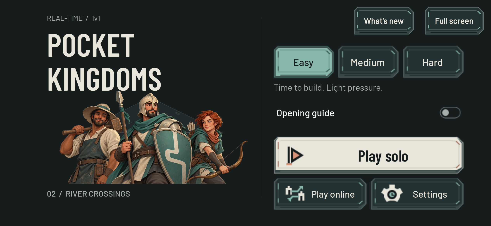
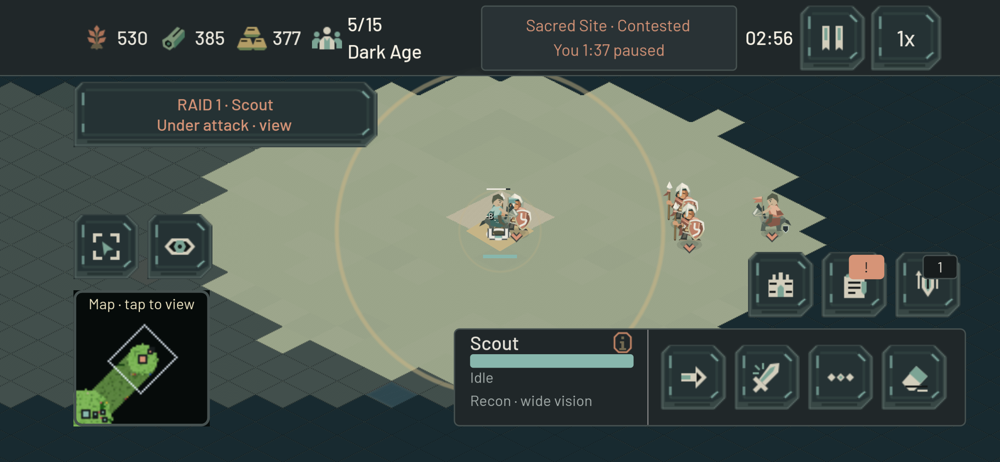

# Pocket Kingdoms morning handoff — 22 October 2026

Live: https://game.4mn.org — **0.2.0-beta.8**. Runtime `c26be0f34f2b90a574f3a30ea75d669f1e382bc1`, published at 06:35:39 UTC from clean committed source. GitHub: https://github.com/ben4mn/RTSM. Publication/documentation commits intentionally follow the embedded runtime revision.

## What is live

- The menu and custom controls share the Builder/Warrior/Archer company identity. Those three characters now read as recognizable battlefield miniatures, and eight building families have original matching architecture.
- The phone canvas fills its viewport. Safe areas protect controls, including Extra Large layouts. Guidance, management sheets, ordinary notifications and urgent raid cards have clearer priority; touch notifications respond once.
- Easy gives the village five minutes before ordinary base raids, uses a smaller field force and regroups after casualties. It can answer a claimed Sacred site from 2:30, so an unattended early Scout no longer wins automatically. Neutral-site initiative remains at 6:30. All units and buildings use normal in-game resource costs.
- Open Plains, River Crossings and Woodland Flanks offer distinct routes, with repeatable seeds. Resource colors and quieter terrain make useful ground easier to read. Army Info explains staging, combined attacks and withdrawal.
- Stand Ground guards respond at their actual stationary reach. Visible Sacred ground no longer has a large badge covering its fighters. Selected own units now retain small hollow foot brackets through crowds and zoom.

These are actual exported-game browser captures at 844×390, DPR3, with simulated notch insets. They are not physical-phone photographs.

## Evidence and deployment

Two clean final exports match. All 40 public payload hashes and 13 private-path denials pass. The final ten-case public multiplayer suite passes ordinary-resource production, movement, replicated combat, Stand Ground and lifecycle/results on the exact frozen runtime. Zero runtime errors; four existing ObjectDB exit warnings remain. All test clients and the final browser are closed.

The last presentation change passes 188 native and 148 headless assertions, including four phone/scale profiles at three zooms, both owner remaps, death/freed-entry cleanup and strict hollow-center pixels. Actual public touch play confirms the cue during damage and its removal when the Scout dies. The full-canvas menu and Pause/menu return also pass, with zero browser errors and two readback warnings.

Easy was compared using normal-resource openings and slower learner policies. The initial six learner matches moved from four losses/two unresolved to six wins; the final objective-response regression retains three learner wins while closing the unattended Scout shortcut. Those are automated calibration results, not beginner certification. Fifteen controlled paid tactical engagements across the three maps support the mixed-army staging guidance.

One isolated native Mac encounter fielded twelve normally purchased mixed troops per side plus ten workers each. Its 29.80-second sample had no render-completion interval over 33.33ms; dense active combat covered 6.856 seconds. This is a debug desktop timing baseline, not display FPS or a phone/Web performance result. No performance change was justified by that one sample.

The public match server was idle before replacement. Game and match containers restarted; the diagnostics collector and tunnel were preserved. Final online image: `sha256:5be908a828aa74006355a5253e0902bacfb6a7b5983fb6e86292e0ba8c2179a2`. Release: `releases/5c363f3a-selected-fighters-20261022`; source SHA-256: `5c363f3a38cb31bb50e5b4a040753cab6237fb328702dec62dd056c8096b45a7`. Postflight verifies zero established match connections/errors and the running overlay hash. Beta.7 remains available for rollback.

Detailed records: [overnight journal](overnight_iteration_2026-10-22.md), [deployment and rollback](debian_game_deployment.md), [Easy response](hold_the_site_2026-10-22.md), [selection cue](selected_unit_cues_2026-10-22.md), [native diagnostic](dense_battle_native_2026-10-22.md).

## What still needs human/device evidence

1. Confirm the edge fill and touch targets on the actual phone, including its installed-app orientation changes.
2. Watch first-time players on Easy. Test whether the first Sacred contest clearly teaches reinforcement/retreat; a lone Scout and two unmicroed Warriors still lose that encounter.
3. Measure longer, larger fights on physical phones and browser exports. The current isolated timing sample is one short Mac encounter.
4. Expand paid reinforcement, flank and withdrawal comparisons across more seeds before adding further combat mechanics. Then extend original character art to Scout, Horseman and Siege roles.

No further runtime iteration is planned before the agreed 07:00 UTC stop. The closing journal entry records the final Git/automation state.
