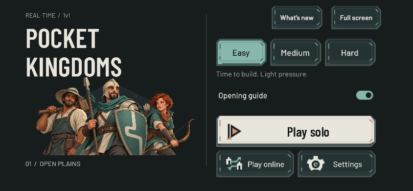

# Full-screen phone edges — 22 October 2026

The reported 1280 × 590 phone screenshot showed game content only between x≈81 and x≈1199, ending near y565. The shell placed `safe-area-inset-*` on the entire `#pocket-game` container, shrinking the canvas and exposing the different body background along both sides and the bottom. This was a canvas-layout issue, not missing artwork.

The new contract keeps `#pocket-app`, `#pocket-game` and the canvas at the complete visual viewport. The backing buffer uses that CSS size multiplied by device pixel ratio once. A hidden CSS probe reads the four safe-area values; `PocketWebShell.getSafeArea()` returns normalized `[left/width, top/height, right/width, bottom/height]` fractions. The Godot bridge maps these fractions once into the current logical viewport, including accessibility scaling. World rendering and menu backgrounds remain full-screen; interactive content uses the safe rectangle.

Consumers were traced explicitly:

| Surface | Safe-area responsibility |
|---|---|
| World, canvas, menu background and modal scrims | Full visual viewport; no inset cropping |
| Main menu, HUD and results | Shared Web bridge; native mobile retains its separate DisplayServer mapping |
| Build sheet, Strategy, pause and hold popovers | Receive the HUD's already-normalized safe rectangle |
| Settings | Inherits its nearest safe-area provider and refreshes on bridge notifications |
| HTML fullscreen, release notes, help and report dialog | Use the same four CSS variables independently of the Godot canvas |

The browser resize path updates inset fractions even if canvas dimensions stay unchanged. Padding changes with a different total size are observed by ResizeObserver. A left/right reversal with the same total inset is refreshed by the real `orientationchange` event, avoiding polling. Listener removal and unchanged-resize suppression are tested.

## Verification

- `tools/test_web_safe_area.tscn`: **24 checks pass** for unnotched/asymmetric/reversed/portrait/screenshot-sized layouts, 115% UI scale, and malformed arrays, booleans, strings, NaN, infinities and impossible bounds.
- `tools/test_web_shell_artifacts.py`: **18 tests pass**, including full-bleed canvas ownership and the exported probe/listener contract.
- Real **Chromium and WebKit**: **80 geometry cases pass**. Each engine exercised 844 × 390 at DPR1 and DPR3, 932 × 430 at DPR3, and 1280 × 590 at DPR1; each profile also rotated to portrait. Each orientation exercised zero insets, a left cutout, two same-size left/right reversals, and top/bottom insets.
- Canvas/app bounds equal the full visual viewport in every case. At 844 × 390 DPR3, the backing buffer remains **2532 × 1170** even when controls use 53px left, 24px right and 21px bottom insets.
- HTML fullscreen and release-note buttons remain inside the safe rectangle and at least **48 × 48 CSS pixels**. Actual help, release-note and problem-report cards stay inside it. Report input fields and buttons retain 48px targets. The real diagnostics script is loaded in this fixture with transport replaced locally, so no reports are uploaded.
- The final Chromium/WebKit matrix also checks `getMenuTopClearance()` against the actual toolbar bounds. It reserves the button bottom plus **8px**, including the safe top exactly once: **68px** without a top inset and **92px** with a 24px top inset, independent of DPR. Hidden and visible toolbar readings agree, so the native menu can reserve space before the HTML buttons appear.
- Restoring the old whole-canvas inset in the browser makes the regression fail immediately because changing the safe area changes the backing-buffer size.

The report dialog was an additional concrete finding: its fixed 10px padding and 44px fields did not follow the shared contract. Its production CSS now uses the safe variables and 48px fields; the real dialog is included in both browser matrices.

Separate exported-game testing found a small overlap between the HTML toolbar and the Godot difficulty control at DPR3 with Extra Large UI. The menu now consumes the normalized toolbar-clearance getter. These fixture assertions verify the getter against real HTML geometry; the parent's actual exported-game test verifies its Godot menu consumer.

The checked-in compact receipt is `docs/phone_edge_metrics_2026-10-22.json`. Detailed local results and native browser screenshots are under `output/playwright/safe-area-{chromium,webkit}-*`. The images are explicitly labeled geometry fixtures; they do not represent game art. The fixture loads the real shell CSS, DOM and resize script but intentionally omits the Godot engine. Actual exported-game layout verification is separate. These are real browser engines with explicit CSS inset overrides, not a claim of testing on physical iPhone hardware.

## Reproduction

1. Build the source-derived fixture: `python3 tools/build_web_safe_area_fixture.py`.
2. Serve it locally: `python3 -m http.server 8873 --bind 127.0.0.1 --directory output/playwright/safe-area-fixture`.
3. Open that URL using Playwright CLI with Chromium or WebKit, then run `run-code --filename tools/run_web_safe_area_browser.js`. The runner creates isolated browser contexts and closes them after each profile.
4. Run the pure mapping scene with Godot headless, and `python3 -m unittest discover -s tools -p test_web_shell_artifacts.py` for artifact checks.

## Actual exported game

The full Godot export was also exercised in Chromium at 844 × 390, DPR3, with touch input and both Standard and Extra Large interface scales. Explicit insets were 53px left, 24px right and 21px bottom, then reversed to 24px left and 53px right during the match without changing the 2532 × 1170 backing buffer. The menu, Display settings, solo match, paid 50-food Villager training, Repeat, Pause and return to Main Menu all worked. The selected Town Center and production state survived the notch-side reversal; returning to the menu retained Extra Large layout and correct toolbar clearance.

This was a dirty development export used for UI verification, not the published artifact or final Easy-balance measurement. The console contained nine expected 501 responses from the local static server's absent diagnostics endpoint and no other errors or Godot runtime errors. Source hashes and the parsed console receipt are in `output/overnight-ui/browser-receipt.json`; screenshots include `output/playwright/fullbleed-final-large-menu-css.png`, `fullbleed-paid-repeat.png`, `fullbleed-reversed-hud.png` and `fullbleed-large-return.png`.

A separate native rendered journey passed all 12 phone/layout profiles, covering paid training/repeat/refunds, Build placement/cancellation, actual unit selection and Move/Attack input, minimap, live resize and GUI input isolation. Its isolated preferences and input receipt are in `output/overnight-ui/`. Neither native desktop rendering nor browser emulation certifies physical-phone performance.

## Public release confirmation

The clean `0.2.0-beta.3` release (`ca46ddbfb13f`, staged source `29fa2b41ff71e53e776584b82220836febc8fbb6f6dcb39b0b205d0d9076dff3`) passed the same real exported-game journey at https://game.4mn.org after publication. At 844 × 390 DPR3, Standard and Extra Large menus, Display settings, paid Villager queue/Repeat, a live asymmetric-notch reversal, Pause and Quit to Main Menu worked. Final body and canvas bounds were exactly x0/y0/844×390 with a 2532×1170 backing buffer. Console errors: zero; two software-renderer ReadPixels warnings occurred during automated capture. The browser was closed after the check.

The public screenshot uses explicit CSS cutout insets; it is not a physical-phone photograph. Full local receipt: `output/room-to-learn-public-browser.json`.
