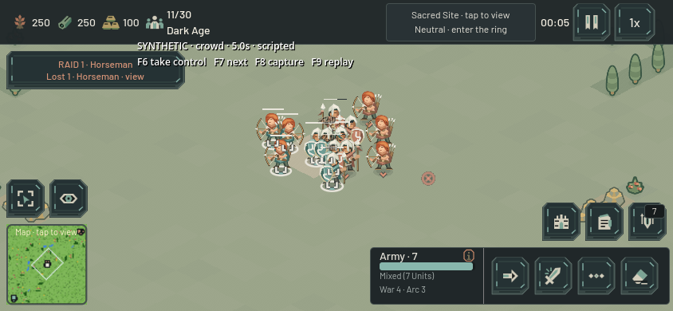
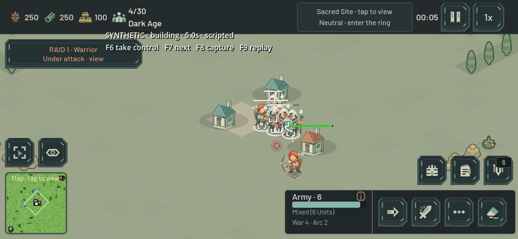

# Combat command polish — 22 October 2026

Two focused iterations followed the existing-game baseline inspection. These changes preserve unit costs, speed, damage, armor, range and attack cadence.

## Repeated target orders

Repeatedly confirming the same enemy canceled the pending attack windup while retaining the already-spent cooldown. In a five-second stationary Warrior fixture, one order dealt 30 damage to a unit or 40 to a building; confirming every 0.1 seconds dealt zero damage. At 0.3-second intervals it dealt only 18/24 damage, and at 0.6-second intervals 24/32.

`command_attack()` and `command_attack_building()` now preserve the accepted route, windup and animation when the valid target is unchanged. The order still changes intent: selecting an already acquired enemy explicitly replaces attack-move/patrol and permits pursuit beyond the autonomous leash. Different targets, Stop and retreat still cancel unreleased attacks immediately.

`test_repeated_attack_orders` compares one order with confirmations every 0.1, 0.3 and 0.6 seconds. Melee, arrows, building approach and a moving target retain identical damage, position, path-request count and cooldown. It also checks autonomous-to-explicit promotion for both target types, patrol/attack-move cleanup, different target replacement, Stop, retreat and autonomous threat retargeting.

The route-feedback regression now checks that promoting the same target retains its valid chase route while removing the obsolete attack-move destination marker.

## Moving-target pursuit

The repeated-order fixture exposed a second issue. A 95-speed Horseman could repeatedly reach a moving 55-speed Warrior's old waypoint, wait a fresh 0.45-second stationary-failure delay and lose contact. The direct-route fixture produced no damage in ten seconds. The actual GameMap/A* fixture produced only two hits, totaling 16 damage.

Exhausting a route to an opponent that has since moved now refreshes pursuit promptly. Briefly entering weapon range retains the accepted route internally, avoiding a new A* request on every range crossing. In-range or invalid targets expose no chase route through the feedback API. New orders, target death and autonomous retargeting still clear obsolete navigation state.

The actual GameMap regression uses ordinary unit stats on controlled flat terrain, with a moving high-health target that does not retaliate. Final ten-second results:

| Measure | Result |
| --- | ---: |
| Damage while target keeps moving | 64 |
| First hit | 2.233 seconds |
| Longest stationary wait outside weapon range | 0.0167 seconds |
| A* route requests, including the runner | 17 |
| CPU for 600 paired unit updates plus assertions | 8.101 ms |

This is a short headless simulation measurement, excluding rendering and a full match; it is not display FPS or phone performance evidence. The controlled direct-route fixture uses 23 path requests including the runner and deals 48 damage. Its results are identical under repeated target confirmation.

The same regression verifies that a stopped target causes no further route requests, in-range feedback hides the internally retained route, target death clears path/navigation state, and a newly blocked chase waypoint reroutes without entering solid terrain. A moving target across a sealed wall still exhausts exactly four route attempts and returns the attacker to idle after 1.967 seconds.

## Validation

Fourteen Godot headless scenes passed with no script errors or warnings in `output/polish-combat-2026-10-22/`:

- New `test_repeated_attack_orders`, `test_moving_target_pursuit`.
- `test_command_path_feedback`, `test_combat_order_priorities`, `test_military_roles_and_timing`, `test_combat_spacing`.
- `test_navigation_live_congestion`, `test_navigation_and_range`, `test_autonomous_navigation_recovery`, `test_force_move_engagement`.
- `test_group_movement_combat_scale`, `test_stand_ground_acquisition`, `test_simulation_target_cooldowns`, `test_combat_damage`.

The existing 20-unit one-cell gap remains 16.9 simulated seconds to complete, with 28.948-pixel minimum final spacing. Existing open/blocked melee overlap fixtures retain their original 120 damage and 26.779-pixel minimum spacing.

Reproduce an individual case with `/Applications/Godot.app/Contents/MacOS/Godot --headless --path . res://tools/test_moving_target_pursuit.tscn` (replace the scene name for the other cases).

These injected tactical fixtures establish command and navigation behavior. They do not replace rendered play, paid skirmishes, multiplayer latency checks or physical-phone testing. The main session log owns those separate observations. No graphical game was launched by this combat subtask during its automated checks.

Remaining battle priorities include rendered building-edge crowding, larger mixed-army fights, more varied pursuit terrain, and physical-device performance. Scout inactivity under attack is intentional: the current Scout is unarmed reconnaissance, with zero damage and no retaliation. The parallel UI pass makes that restriction explicit.

## Interactive rendered fixture

`tools/render_polish_combat.tscn` runs the actual Main scene, GameMap, A*, selection, command dispatch and HUD with a clearly labeled synthetic roster. It grants capacity and freely spawns normal-stat troops/buildings, freezes the ordinary AI/base units and reveals fog. It does not claim a paid opening or calibrated battle outcome.

Launch natively with `/Applications/Godot.app/Contents/MacOS/Godot --path . res://tools/render_polish_combat.tscn -- --output=res://output/polish-combat-native`. Three 20-second phases exercise a moving infantry target with repeated Horseman attacks, an eight-versus-eight mixed crowd, and a one-tile House corridor leading to an enemy House. Scripted commands include Stop, retreat, reengagement and changing from the building to a nearby enemy.

F6 transfers control to the observer while simulation continues. F7 advances the scenario, F8 saves an extra screenshot, and F9 restarts the current scenario. `--manual --phase=runner` (or `crowd`/`building`) starts without scripted orders; `--width=932 --height=430` changes the native window. The fixture also exposes `take_control()`, `jump_to_phase()`, `capture()` and `finish()` for MCP invocation.

Native runs save before/mid/after screenshots plus `report.json` containing source hashes, command events, actual damage, survivors and bounded callback-interval samples. Timing includes screenshot readback and other observers, so it cannot substitute for isolated rendering measurements. The fixed-FPS headless tuning run completed all three phases with 135 unit-hit events, zero navigation failures and no script errors; its output is `output/polish-combat-fixture-headless/report.json`. Native observation belongs to the root session's subsequent play record.

The first native runner capture exposed an error in that initial fixture: Main refreshed fog after the one-time grid mutation, and the TileMap fog overlay retained its cells. That attempt is not usable visual evidence. The fixture now supplies `tools/fixtures/polish_revealed_fog.gd` through the ordinary FogManager refresh API, hides the fog display layer, and removes the Sacred world's artwork/annotation from the combat arena. Troop and sprite visibility are asserted after six Main frames. These are fixture-only changes; production fog behavior is untouched. Corrected runs use a separate output directory so the raw failed attempt remains available.

## Corrected native and interactive replay

The corrected 844×390 native embedded-window run completed all three 20-second phases. Its record is `output/polish-combat-rendered-2026-10-22-automatic/report.json`: nine screenshots saved successfully, 131 actual unit-hit events and zero navigation failures. The root session observed the running scenarios and reported no engine log errors. All five recorded source hashes match the reviewed working files; UnitBase is `03a143a8db9af937604bf7bcf15cdd9628baa2abc3aaa66a2dce4a60ff87507d`.

| Native phase | Unit-hit events | Player 0 / player 1 unit damage | Surviving fixture units |
| --- | ---: | ---: | ---: |
| Moving target with repeated orders | 10 | 56 / 45 | 1 / 1 |
| Eight-versus-eight mixed crowd | 90 | 390 / 390 | 1 / 1 |
| House corridor and target switch | 31 | 95 / 180 | 4 / 0 |

These are three controlled engagements at ordinary unit stats, with different outcomes from the fixed-step headless tuning run. They are not balance comparisons. The hit observer records unit targets only; the table does not include damage dealt to the House.

Visual review confirms visible terrain and troops, team colors, selected foot brackets through the crowd, health bars and ordinary battle feedback. The corridor view shows the physical House obstacles and the approached enemy House without a Sacred badge covering the fight. Some miniature overlap remains in the dense melee. The small synthetic-fixture caption overlaps the raid card; that caption is confined to this test scene.

The subsequent interactive replay transferred from scripting with F6, changed phases with F7, then exercised repeated native right-click attacks, simulated-touch Move/retreat, the native T Stop shortcut, Space camera framing and corridor building attacks. The captures and `manual-combat-report.json` are in `output/polish-2026-10-22/`. That report matches the same five source hashes, records 87 unit-hit events and zero navigation failures, and contains completed runner/crowd phase summaries. Its building phase has captured hits and screenshots but no final phase summary; do not treat it as a finalized three-phase report. The touch actions were synthetic input on the Mac, not testing on a physical phone.

The automated command record includes scheduled event markers as well as actual dispatch. In particular, the runner's `reengage` marker is logged at 14 seconds even though that phase intentionally skips the reengagement command. Repeated 0.3-second attack confirmations are executed but not logged individually. The observer's interactive inputs are established by the session's input trace/captures rather than the fixture's sparse command log.

Performance remains a separate open gate. The native observer recorded a 1,047.999 ms maximum callback interval in the runner phase, 93.335 ms in the crowd phase and 77.530 ms in the corridor phase. Samples include screenshot readback and concurrent observation/tool activity, and provide no isolated before/after baseline. They cannot establish either display FPS or the absence of a performance regression. An isolated longer native/Web/physical-device comparison is still needed.
