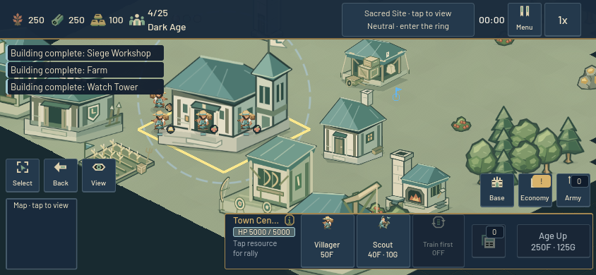
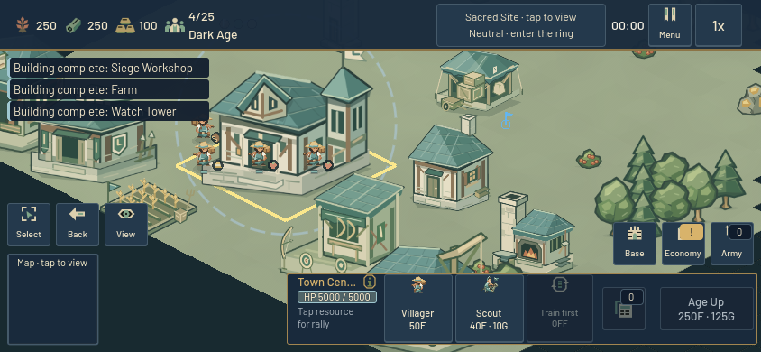
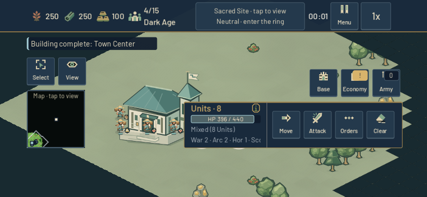
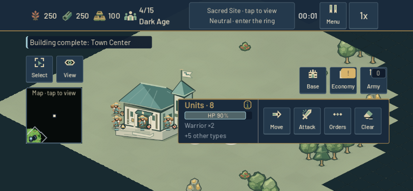
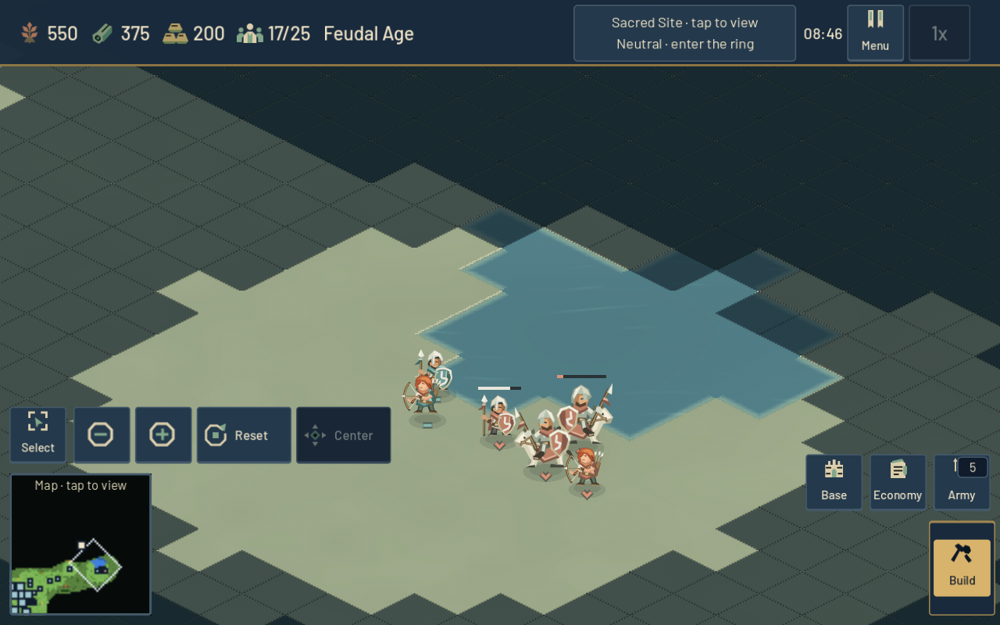
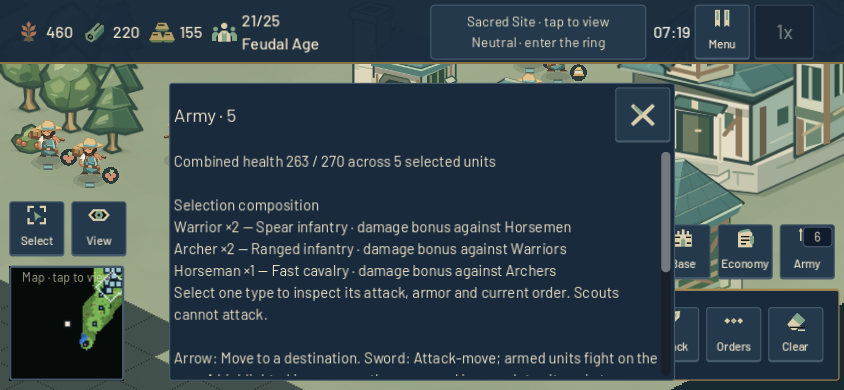
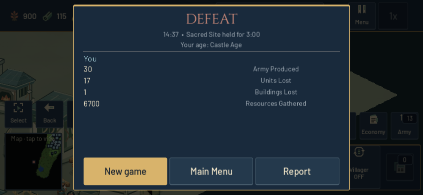
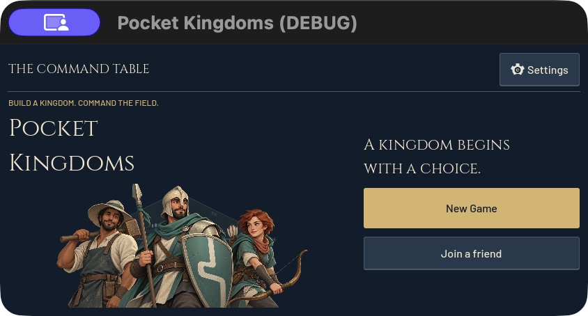

# Read the battle — 24 October 2026

Beta.13 is published at [game.4mn.org](https://game.4mn.org/). This graphics and interaction pass builds on beta.12 (`b0e484c` checkout, deployed runtime `7681103`). It improves mounted troops, siege equipment, architecture, construction and army inspection. Combat statistics, prices, footprints and authoritative attack timing remain unchanged.

## Visible changes

- Cavalry has a pale horse, armored rider and broad team shield, distinguishing it from the dark, unarmed Scout. Siege uses a timber-and-steel carriage with clearer wheels, bow and ownership cloth. Its movement stays grounded; attacks recoil after the existing projectile release.
- Ten building families gain roof courses, stronger eaves, timber bracing and restrained stone detail. Town Centers gain a civic gable; production buildings retain distinct working bays. Opponent variants change ownership material while preserving neutral walls and wood.
- Construction grows from the footing, with a faint identifying silhouette and three temporary timber stages. Completed buildings remove the frame and shader. Actual HP loss produces a short warm pulse; repeated hits, reduced flashes and destruction preserve the correct appearance. Online replicas expire the same pulse through their existing visual clock.
- Mixed selection shows a stable, counted composition. Tap Info exposes the full roster, unit roles and combined health; single-type selections also show attack, armor, range, stance and order. Online enemy attack/armor are explicitly base values because enemy research is not disclosed by the server. Owned units show current upgrades.

The [building report](building_character_2026-10-24.md), [mounted-unit report](company_mounted_units_2026-10-24.md) and [army-inspection report](army_selection_readability_2026-10-24.md) retain before/after images, exact source manifests and durable component archives. Component fixtures distinguish synthetic presentation from ordinary gameplay.

| Previous phone village | New architecture |
| --- | --- |
|  |  |

| Previous phone selection | Readable composition and Info |
| --- | --- |
|  |  |

## Baseline and validation scope

Before editing, a fresh headed Chrome client loaded the verified beta.12 public export, started an ordinary solo match, bought a Villager with H/Q, opened construction with B, resized from 1280×800 to 844×390, and returned through Pause to Home. This was an opening, not a completed match. Screens and receipt are in `output/playwright/arms-baseline/`. Read-only deployment verification confirmed all public payload hashes and server runtime hashes, healthy unchanged infrastructure and no active match sockets.

Component rendering runs use serialized native Godot windows at desktop and phone-sized resolutions. Building views preserve identical geometry, roster, camera and viewport: finished village draws stay 264 at 1280×800 and 253 at 844×390. Nine simultaneous foundations add nine temporary nodes and draws. Those counters do not measure GPU duration or whole-match performance.

Mounted-unit fixtures preserve all fourteen paired gallery counter samples and all 106 structured hit records in the scripted crowd. The latter uses fixed 60-FPS simulation and synthetic armies, so callback intervals are excluded from performance conclusions. An implausible texture-memory reading is also preserved and excluded. HUD checks pass 468 native and 468 headless assertions, including the 96px minimum identity column, Extra Large and modeled browser/safe-area clearance. Real Main/SelectionManager and snapshot replicas validate own upgrades and explicitly undisclosed enemy research in both server-slot mappings.

Ten combined headless suites pass without errors/warnings: worker cargo, inert replicas and building pulse, Farm commands, construction clearance, damage/progression, HUD pointer routing and first-show/phone menus. The integration source matches all 1,183 relevant primary runtime/tool/web inputs. Runtime and tests are committed as `e2359dd57283eea5ca8edffbbb841e2f9bdbeaae`.

Review corrected a double-sampling construction shader before rendering and a SceneTree fixture's early autoload dependency before integrated execution. The building pair first rejected a fixture scaling/layout error, then reran both revisions cleanly. The former Tower replica assertion was already stale on the baseline; it now covers all ten building families plus construction cleanup. Failed attempts remain in the component archives.

The attempted fresh native timing baseline lost focus during settling. It recorded no measured frames and was rejected; its source, logs and failure receipt remain in `output/iteration-2026-10-24/native-baseline/`. No new FPS or native cadence comparison is claimed from that attempt.

Fifteen local multiplayer cases pass, including private rooms, nine map-catalog pairings, paid construction/recruitment, combat and lifecycle recovery. All 18 processes use distinct private preferences. Runtime errors are zero; four clients report ObjectDB instances leaked at shutdown. These warnings remain in the evidence. This run covers attack-move, not the optional Stand Ground scenario.

## Exact export and deployment

Two clean exports from `e2359dd` reproduce substantive payloads and source manifests. Packaging checks pass for closed checksums, stock WebAssembly, and developer/credential exclusion. The sealed server includes 462 committed runtime source files; all 798 running runtime hashes match.

Headed Chrome played the exact canonical export at 1280×800 and 844×390. Actual Settings selected Extra Large; direct Join entry, scrolling, Solo transition and resizing remained usable with the web toolbar visible. Ordinary H/Q trained a Villager. B opened construction; an adjacent House preview rejected insufficient spacing, a clear placement completed through the new foundation frame and raised housing. A paid Scout's Info correctly showed its unarmed role, zero attack, stance/order and explanatory text. Info close, Pause and actual Home return passed with zero console errors/warnings. This opening is not counted as a completed match.

Remote `main` was verified at `e2359dd` before publication. Cutover switched the static release at **01:08:55 UTC**, after the zero non-LISTEN socket guard and replacement of only `online`. Nginx, diagnostics and tunnel retain their original identities/start times. Public trusted HTTPS verifies all 40 payload files, expected MIME/cache/isolation headers and 13 denied private paths. Beta.12's sealed source, static release and image remain available for rollback. The guard/replacement retains a small admission race; no traffic gate was added.

| Release identity | Value |
| --- | --- |
| Version | `0.2.0-beta.13` |
| Runtime commit | `e2359dd57283eea5ca8edffbbb841e2f9bdbeaae` |
| Source tree SHA-256 | `10c5365c11ffad5855942b330e1739619bfb2b561220901ef139485a70244595` |
| Static target | `releases/beta13-e2359dd57283-c5f84fcde0-e6754b0fc7` |
| Server image | `sha256:0bab19c5837b2bac8861e2c7a00c96ec0b078d482af06e19deec220686a1657d` |

Clean build artifacts are retained in `build/deployed-beta13-*`; source/build/deployment receipts are in `output/iteration-2026-10-24/`. The public River match and final handoff are recorded below. Physical-phone testing is outside the evidence collected here.

## Deployed browser playtest

Two actual headed Chrome clients joined private room `VLUCZJ`, match 1, River seed `1429540410`. Host map changes propagated; the guest could not change the host's map. Host remained 1280×800; guest used 844×390 with Extra Large chosen in actual Settings. H/Q training and B construction panels passed on both. The sustained match used the existing test-only policy to issue ordinary paid commands; no resources, actor state, clock, victory or defeat were injected.

During live combat, desktop Info showed the owned Warrior's upgraded attack 10/armor 3/range 1 and stance/order. Both mixed-army panels showed counted roles and exact combined health. The phone panel fit Warrior/Archer/Horseman composition and role text. A later scroll attempt coincided with selection changes as units died and did not establish scrolling; the separate native fixtures cover scroll contents.

| Deployed desktop combat | Deployed phone Info, Extra Large |
| --- | --- |
|  |  |

The natural result was **14:37, Sacred Site held for 3:00**, winner slot 0, received by both clients at 877.17–877.18 wall seconds. Both settled result screens and actual Main Menu returns passed. Both reached Castle Age, researched Loom/Wheelbarrow/Forging/Scale Mail, maintained six completed Farms, gathered and delivered cargo, and trained infantry/archers/horsemen. Host/guest trained 32/30 military and lost 20/17 units. Building-loss coverage includes the policy's paid demolition; it is not proof of combat destruction. Browser siege-unit recruitment was not observed; siege art/release behavior is covered by the native fixtures.

The analyzer passes with 799 matching sampled ticks and zero disagreements across 4,208 shared actor fields. Fog yielded no shared resource-tile comparisons, so none are claimed. Browser console, page, HTTP, socket and controller errors are zero. Six placement attempts were rejected: one outside the map and five requiring clear visible ground. Sequences have no rejection IDs, so exact command attribution is not asserted. Four PCK/WASM startup `ERR_ABORTED` receipts remain; all required responses were HTTP 200 and both games completed, but missing `requestfinished` events prevent a strict completion-order claim. Independent public payload hashes passed.

The final 98.92 game seconds took 98.94–99.02 collector wall seconds. Prior beta.12's final 99.75 game seconds took 100.24–100.33 wall seconds. Both are observational paid matches with different seeds/rosters, not controlled performance comparisons. Current sampled snapshot progression was 7.78 ticks/second; this does not measure browser FPS or network latency. Late Docker CPU samples reached about one CPU of the 1.5-CPU allowance, with no restart/OOM; samples are not continuous utilization.

## Publication and handoff

Postflight at **01:26:48 UTC** reconfirmed all 798 running runtime hashes, all 40 public payloads, the same server/static/infrastructure identities, healthy diagnostics, zero restarts/OOM and zero sockets in every non-LISTEN state. Both test browsers were closed; the clean build worktree was archived. The updated primary project imported without errors/warnings, and all 477 checked runtime/scene/asset/web files still match the committed source. The native game was launched normally and its main menu visually confirmed through computer use on the unlocked Mac. It remains running with the user's preferences.

The aggregate archive `docs/evidence/iteration-20261024.json.gz` preserves the selected source manifests, failures, tests, browser events, timing, deployment and handoff receipts plus image hashes. Three linked component archives retain their paired fixtures. The archive excludes browser profiles, private diagnostic bodies, credentials and build binaries. Canonical/reproduced exports and rollback context remain available at the paths above.

Aggregate archive: **152 receipts and 107 image hashes**, SHA-256 `7b1f492c7a4fd21b13a322e2cb7c7af6e7a86f26addb3d34ba669e97e3af5549`. Final independent live review passed with no findings.
