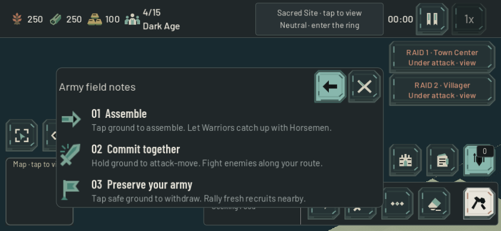

# Read the ground — 22 October 2026

Version `0.2.0-beta.6` improves river-edge and resource readability and separates ordinary feedback from management sheets. Gathering, map generation, navigation, combat and paid-economy rules retain their existing behavior.

## Notification priority

HUD now owns ordinary-notification visibility. Economy, Army, Info, Help, world-context sheets and full modals suppress the feed. The existing message lifetime continues: closing a sheet restores only messages that are still current, without replaying expired feedback. Compact View/More/Queue controls retain their gesture instructions. Persistent Sacred status and the two reachable raid cards remain available through their existing UI.

Previously, BattlefieldFeedback refreshed `feed.visible` directly on every update; it could revive a toast behind a sheet even after another UI layer hid it. It now reports raid activity through the HUD's single visibility decision. Raid expiry cannot revive background messages underneath Army notes.

The same actual-touch fixture exposed an existing double invocation of actionable toasts. Godot could deliver a native contact and its emulated mouse/touch companion; both reached the callback. The handler now consumes the emulated companion without invoking the action and rejects canceled touches. Real touch and physical mouse each invoke once, including both emulation directions. This preserves the existing press-to-act behavior.

The final fixture produces **40 expected failures on beta.5 and zero on the candidate**. Four actual native touch journeys cover 844×390 and 932×430, Standard and Extra Large, with natural queued layout. They verify live/new/expired messages, Economy/Army/notes/Build/Pause transitions, repeated raid refresh, raid expiry, actionable field messages, both pointer-emulation directions, canceled touch, preserved selection/banks and zero world orders. The first draft used a nonexistent resource-manager property; that test-only error was corrected before recorded comparisons. The final baseline includes all additional pointer cases.

Existing guide/raid-priority journeys, the twelve-profile secondary-surface regression and the twelve-profile Army notes check also pass. The fixtures use isolated preferences and hold AI/economy where needed. These are UI and input-contract checks, not paid full-match or physical-phone evidence. An independent source review found no actionable lifecycle or input-routing issue. Local evidence: `output/notification-priority/` and its source receipt.

## Terrain and resources

The [terrain receipt](terrain_readability_2026-10-22.md) records sixteen paired views and 21,581 atlas/geometry/depletion assertions. The [resource receipt](company_resources_2026-10-22.md) records both native renderers, exact alpha/canopy preservation, six phone/zoom views per renderer and five interaction/gathering groups. Existing Kenney silhouettes receive new materials; no new resource illustration is claimed. The integrated native four-profile toast journey also passes with all final terrain/resource files present. The [independent integrity receipt](presentation_integrity_2026-10-22.md) additionally records nine exact map/path comparisons, six baseline/candidate resource snapshot cases, three existing regressions, ten local multiplayer checks and three map-catalog pairings. No runtime errors; three existing ObjectDB shutdown warnings remain in the online harness.

## Browser gameplay review

The development export was inspected at 844×390 CSS pixels, DPR3, Extra Large UI and synthetic left/right/bottom safe insets of 53/24/21 pixels. The canvas fills the viewport at (0,0). Settings, menu, ordinary paid Scout production, world movement, Sacred focus, Pause and menu return work through real browser input. River Crossings seed **101** is confirmed by the application's own bounded diagnostics context, rather than inferred from a typing screenshot.

One Scout was purchased through the normal Economy UI (40 food, 10 gold), then moved to the Sacred Site. At game 3:25 the human held the site with 1:57 remaining. At 6:58 the Scout was gone, population had fallen from five to four and the enemy was capturing the site at 90%; the later Pause view shows enemy ownership. This partial match was quit normally after seven minutes. It does not demonstrate a Scout-only win or certify Easy balance; the exact intervening fight was not continuously observed. Repeat this opening with controlled observation before changing objective timing. A Rally order was entered after training was likely complete, so no claim is made that the Scout followed that rally.

The visible meadow/resource presentation was reviewed in the browser; fog and the camera view did not expose a clear river bank in this journey, so the shoreline claim relies on the native paired views. The local static preview has no diagnostics POST handler: eleven expected HTTP 501 messages and three software-renderer readback warnings are retained, with no engine/script errors. This dirty development export is never published. Native and software-rendered browser captures are not physical-phone or rendering-performance certification. Raw captures and console evidence are under `output/playwright/ground-preview-*`; the concise receipt is `output/ground-preview-browser.json`. Public clean-artifact checks are recorded after publication.

## Public release and earlier Scout opening

Beta.6 is live from clean runtime `c61918e45853a086cbdbcc99b860a0decdf1c402`, staged source `efeaba3c86f81f7637997de0bf71b86028ace1f5eedabaae08e335aa87c19ef9`. Two independent exports match; all 40 public payloads, 13 private-path denials and the complete ten-case public online suite pass. Four ObjectDB exit warnings remain in that online run, with no runtime errors. Server postflight reports no established match clients or errors and all six changed runtime/shader hashes match. Exact deployment/rollback identity is in the [deployment receipt](debian_game_deployment.md).

A fresh public 844×390 DPR3 browser confirms the clean served/runtime identity, full canvas, Extra Large/asymmetric-safe-area layout, Economy/Army/notes transitions and shader presentation. One Scout purchase shows the exact bank change 310F/115G→270F/105G; a Sacred rally entered at 11% training produces actual movement after completion. This earlier browser opening captures around 1:31 and **wins at 4:30 without combat**, with one human army unit produced and zero losses; the AI result shows seven army units produced. The result returns normally to the menu. Console: zero errors and two software-renderer readback warnings. Receipt: `output/ground-public-browser.json`.

This complete browser game exposes a timing gap missed by the later preview opening. An independent natural paid probe confirms immediate Scout wins at 233.45s on all three maps / seed 101, with no contest or damage, while Easy's unconditional 300s objective gate holds its paid troops back. That is a balance issue for the next bounded iteration, not an effect of these presentation changes. Investigate a separate reactive Sacred response while preserving 300s base raids, 390s neutral initiative, small squads and 45s regroup; repeat slower learner matches before publishing any AI adjustment.
