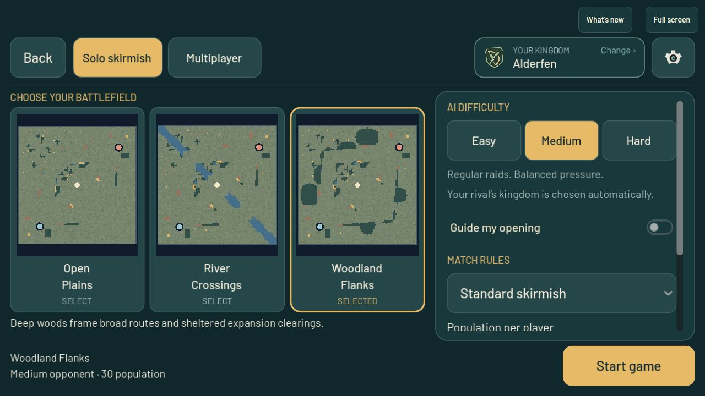
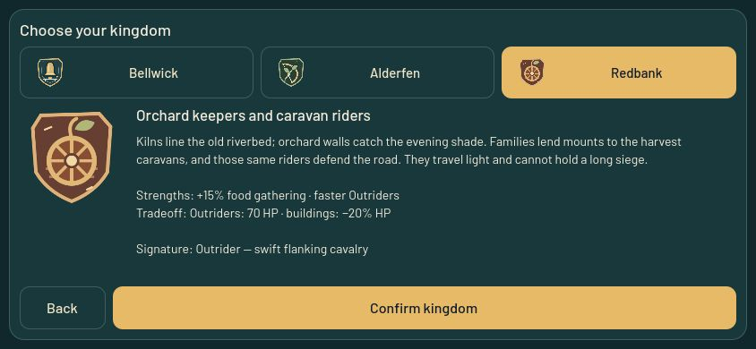
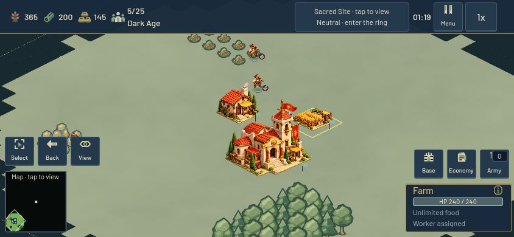
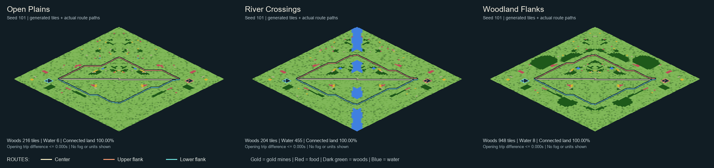
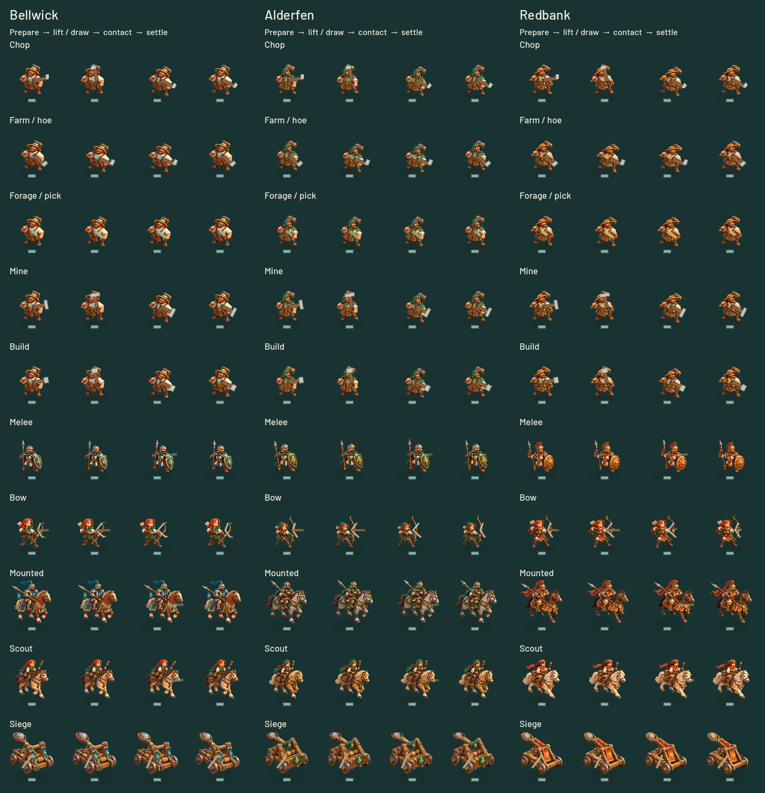

# Room to settle — beta5

The owner asked to remove the confusing pair of civilization selectors, make maps less cramped and resource-starved, give the civilizations more character, and add basic farming, chopping and attack animations. Version `0.3.0-beta.5` implements that scope. The committed source, checks and publication receipts are recorded below.

## One settlement choice

New Game presents one player settlement control. Solo play chooses one of the other two settlements from the actual map seed, so a fixed seed and player choice reproduce the same rival. Random stays Random for the next match. Multiplayer continues to use the authoritative player's slot and displays the opponent without allowing changes to their choice.

The picker hides before dismissal callbacks, ignores repeated confirmation, and discards a choice if its lobby or loading context changed. Selected names no longer repeat in the footer or confirmation action.

## Places with a history

The stable civilization IDs and existing balance remain intact; the public identities are now:

| Settlement | Local craft | Emblem | Play identity |
| --- | --- | --- | --- |
| Bellwick | Bell-founders and millwrights who maintain the town bridge | A cast bell above the bridge rail | Flexible army and full-strength defenses |
| Alderfen | Marsh hamlets joined by a raised road; reed-cutters and patient bowyers | An alder branch inside a bow | Faster woodcutting, long-range but fragile archers |
| Redbank | Orchard keepers and kiln workers who mount the harvest caravans | A wagon wheel with an orchard sprig | Faster food gathering and mobile riders, weaker buildings |

The emblems are authored vector drawings with restrained palettes and simple silhouettes. Their higher-resolution imports also remove the enlarged crest blur. The existing miniature sprites are retained, with action poses bringing more character to their work. No new raster generation was used for this pass.

## Room and resources

Maps grow from 72×72 to 88×88. Starts move from six to fourteen tiles inside the edge, preserving the former 59-tile base-axis separation. Larger home clearings, broad routes and stocked expansion compounds create room for farms, production and flanking movement. Terrain is reflected across the diagonal for equivalent starts; resources remain finite and must be gathered and delivered normally.

This changes the terrain generated from a seed, including Open Plains. Online protocol 4 and map catalog/generator 3 require matching clients and authority. Both quick matchmaking and private rooms reject older catalogs before admission. This protocol change does **not** include the previously rejected six-minute scoring delay: Standard retains its existing 180-second armed Sacred control rule.

## Visible work and combat

All three settlements use distinct chopping, hoeing, foraging, mining, building, melee, bow, mounted and siege presentations. Workers reach toward berries without a tool; only actual Farms use the hoe. Work phases derive from the real gathering/building clocks. Attack windup, release and recovery derive from the existing attack clock.

A persistent presentation helper draws small tools and weapon motion; it does not award resources, deal damage, create continuous particle streams or allocate a new effect node every cycle. Visible online actors receive only bounded action/phase/period data; replicas remain simulation-inert. Reduced motion and reduced flashes are respected. These are procedural 2D poses over the miniature sprites, not a skeletal or frame-by-frame animation pack.

## Verification and publication

Focused source checks passed: single-picker lifecycle (485 assertions), phone menu geometry and map-preview projection (2,177), mode reflow (1,304), actual solo startup/rival selection, civilization rules, action presentation (342), and natural multiworker gathering/dropoff. A real loopback WebSocket check covered nine absent/old/mixed/unknown/current map-catalog pairs; only the current pair reached match/start/snapshot. Twenty web packaging/update tests passed.

Map checks covered 25,721 assertions over nine measured before/after maps, 105 archetype cases and 64 opening-fairness cases. Terrain-only 4x4 home construction anchors increased from 51 to 235; the nine measured maps had fully connected walkable land. The broader suite's minimum was 99.972%, with required resources and routes reachable. Local generation median increased from 32.0 to 65.2 ms. See [the map measurements](map_homesteads_2026-10-24.md) for stock and performance limits.

The action contact sheet and three-map topology sheet were rendered and visually inspected. The existing armed Sacred victory rule also passed 42 focused rule/AI assertions.

The bounded paid-policy River match reached the 480-second progress report with resource deposits on both sides, paid Camp events and 160 damage-active simulation seconds. It hit its 240-second wall limit before completing the intended 600-second horizon and did not produce a final match receipt. Its preserved log is partial gameplay evidence, not a completed-match or pacing pass; it was not rerun as an open-ended matrix.

The local 844x390 browser preview passed single-choice setup, Bellwick/Redbank crest and history inspection, Redbank River startup, paid Villager recruitment, completed House and Farm, assigned Farm worker, resource delivery and menu return. The public browser passed normal reload/launch, updated setup and map previews, Alderfen Woodland startup and menu return. Neither browser showed console warnings or errors during these checks. The static local preview intentionally has no diagnostics POST endpoint and recorded HTTP501s; public diagnostics are unaffected.

## Published release

**Published:** `0.3.0-beta.5` from `f905d4a7bce8b83975dcb8091e8c7c8ae47185c8`, protocol 4/map catalog 3, at 2026-10-24T22:10:10.960323+00:00. Canonical and independently reproduced Web packages matched. The isolated Linux server smoke passed; guarded activation restarted the dedicated game service and switched the static release. Public HTTP/server postflight passed for 925 active runtime files. Beta4 is retained for rollback.

- Release identity: `v030beta5-f905d4a7bce8-edce08e5fb-bd566edb05`.
- Web manifest SHA-256: `edce08e5fbe1ebbc2a296354b055ba151f3ab786ac34b7dcc1982f47819e65fc`.
- Server manifest SHA-256: `bd566edb0508b3d336aad8ccbf14a75f20db8000ec6db3c203ec15467239d319`.
- Activation receipt: `/home/ben/aoem/deployment-backups/v030beta5-f905d4a7bce8-edce08e5fb-bd566edb05/activation.json`.
- Local evidence: current recovery workspace `work/beta5-settlements-20261024/`, including build, validation, Linux smoke, activation, postflight and browser records.

## Remaining work

The previously reproduced long-idle browser WebGL allocation failure remains open. This release does not claim to fix it. Physical-phone performance, attentive match pacing and deeper terrain/HUD art coherence still need evaluation. Keep future work bounded, preserve evidence and publish completed checkpoints.
