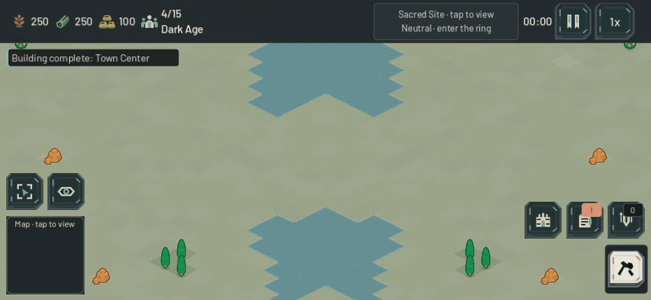

# Terrain readability — 22 October 2026

The field now has quieter grass variation and a narrow bank/shallows treatment along land-facing water edges. This is a presentation change: generated maps, resource placement, crossing widths, forest costs, pathfinding, collision, selection and fog rules are preserved.

The native River Crossings baseline showed broad, recognizable routes, but repeated grass diamonds competed with their edges. The accepted change deliberately keeps the existing shapes rather than drawing roads or route arrows. Grass-variant channel contrast is approximately halved, and grass grain amplitude is halved. Forest/resource surface colors remain unchanged. The shoreline is restrained at phone scale; quieter ground is the larger improvement.

| Before | After |
|---|---|
|  |  |

Both views use an actual 932×430 Main scene, seed 101, upper river crossing, zoom 0.65. The [woodland gap view](images/terrain-woodland-gap.png) uses zoom 0.952. These are stopped, fully revealed visual fixtures, not player scouting or paid-match evidence. Resource materials and HUD are the isolated baseline versions so this comparison changes only terrain.

## Runtime contract

Only `scripts/map/tileset_builder.gd` and `scripts/map/game_map.gd` change. The nine original atlas columns retain their TileType indices. Fifteen appended water variants encode four land-neighbor bits in grid order −X, −Y, +X, +Y (screen NW, NE, SE, SW). GameMap chooses the variant once during terrain construction. Out-of-map neighbors do not create banks. There are no new scene nodes, shaders, per-frame shoreline updates or changes to TileMap geometry.

Each variant copies the unchanged base-water texture, then paints only existing opaque pixels near its flagged edges. A narrow warm bank and muted shallow-water tint stay inside the original water diamond. Water interiors and water-to-water seams remain unchanged. Resource depletion changes land to grass, so water adjacency does not change; existing hidden-depletion memory and reveal behavior remain intact.

The atlas grows from 576×32 to 1536×32: raw RGBA pixels increase from 73,728 to 196,608 bytes, an extra 120 KiB. It remains one shared atlas on the existing TileMapLayer. This is a bounded storage description, not an FPS or mobile GPU performance claim.

Frozen source hashes:

- TilesetBuilder: `2ee703276980c3d9fa7cbf4e24812bfcf6e1342322b82e934f7c7f137fff2792`
- GameMap: `942726ed22b808301c9e2baac1d0445dd15c431181afe22b24d9d06a2504344f`

## Validation

`tools/test_terrain_presentation.tscn` passes 21,581 assertions on the candidate. It checks all fifteen variant alpha masks, each edge's direction, unchanged water interiors, no added collision, correct atlas choices across all 5,184 cells of each instantiated map, unchanged grid after visual rebuilding, and unchanged scene-node count. Actual resource depletion verifies immediate simulation change, preserved explored-only terrain/minimap memory, update only on current reveal, and unchanged shoreline cells. Existing `test_resource_fog_targeting` also passes.

Baseline `ec6a3da` and candidate each produced sixteen native Metal captures: 844×390 and 932×430; River center/upper/lower crossings at zoom 0.952 and 0.65; both Woodland flank gaps at zoom 0.952. Actual Main/GameMap scenes and the HUD are present. Wider views expose the river interfaces that the center objective ring and HUD partly crop at the closer scale. The fixture calls the existing camera methods, without changing production framing.

All four map/profile records match exactly between baseline and candidate: full grid hashes, all three tactical route-path hashes, resource counts and terrain-cell counts. Base-water and fog-atlas byte hashes also match. MapGenerator, Pathfinding, MapData, FogManager and SelectionManager remain byte-identical to `ec6a3da`. Final native logs contain no errors or warnings. The separate independent validator checks additional seeds, all archetypes and individually usable river crossings.

## Reproduce and limits

Use an isolated project copy with a unique Godot custom user-data directory:

```sh
/Applications/Godot.app/Contents/MacOS/Godot --path <isolated-project> \
  res://tools/test_terrain_presentation.tscn -- --output=<absolute-directory>
```

For the baseline, use the same final fixture with the two runtime files from `ec6a3da` and add `--baseline`. `--headless` runs the contracts without claiming screenshots. The fixture requires all four maps to complete and, when rendered, all sixteen captures to exist. Initial drafts caught an invalid constant expression and a typed-array conditional in the fixture; both were fixed before the recorded final comparison. Earlier unversioned captures in the output folder are superseded by the `-zoom` filenames in the final receipts.

The [compact receipt](terrain_readability_metrics_2026-10-22.json) records hashes, atlas sizes, matching map/path records and capture names. Raw logs and paired captures are under `output/terrain-20261022/`; `stage.txt` identifies the isolated project. Native windows were serialized with other agents. No FPS benchmark, public requests or actual-device test was performed. This pass does not change the angular grid shoreline or add terrain depth/animation; acceptance is limited to a modest readability improvement at the inspected phone scales.
